# Архитектура — Умный кредитный кабинет предпринимателя (хакатон и целевая)

Oct 12, 2026 · @egorik

## 1. Обзор

Главное в архитектуре — движок ИИ-подбора кредита: он берёт данные о компании (реальный реестр + демо-данные банка) и ситуацию клиента, описанную своими словами, и выдаёт рекомендацию с параметрами, шансом одобрения и объяснением. Четыре расширения встроены в этот же конвейер: дают ему данные или продолжают путь клиента после него. Документ соответствует ТЗ версии 4.2 и бизнес-требованиям кейса (они главнее при любом противоречии); идентификаторы требований (REC-, NEED-, SC- и другие) — из ТЗ; язык разработки — Python 3.12, стек — в разделе 21.

### 1.1. Цель кейса и как она решается

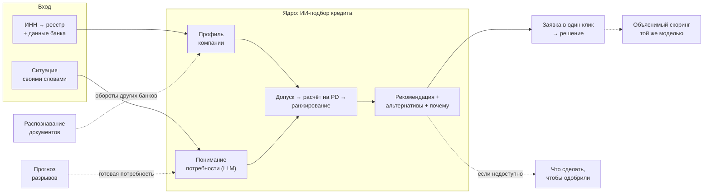

| Часть | Роль | Раздел |
| --- | --- | --- |
| **Ядро: ИИ-подбор кредита** | Профиль компании + понятая потребность → допущенные продукты → расчёт предложения на PD-модели → прозрачное ранжирование → рекомендация и альтернативы с объяснением | 3 |
| Распознавание документов | Добавляет в профиль обороты из выписок других банков; подбор пересчитывается | 4 |
| Прогноз кассовых разрывов | Формирует потребность до того, как клиент написал: цель, сумма дефицита, срок | 5 |
| «Что сделать, чтобы одобрили» | Если лучший продукт недоступен — минимальные изменения, которые дают «да» | 6 |
| Объяснимый скоринг и честный ассистент | Решение считается той же моделью и формулами, что и подбор; ассистент объясняет, но не обещает | 7 |

### 1.2. Архитектурные драйверы

| Драйвер | Требование | Как обеспечиваем |
| --- | --- | --- |
| Точность подбора | top-1 ≥ 85% к эталону экспертов | Гибрид: LLM только понимает текст, продукт выбирает движок на правилах и моделях; оценка на эталонном наборе в CI |
| Согласованность подбора и решения | 100% заявок на параметрах варианта получают итог, соответствующий шансу (Q-06) | Одна PD-модель, один FeatureBuilder, одни формулы лимита и ставки |
| Объяснимость | «Почему этот», «почему не тот» — на любой вопрос | Снимок подбора хранит причины допуска и вклад каждого фактора |
| Отзывчивость | Подбор ≤ 3 с; первый фрагмент ответа ≤ 2 с; what-if ≤ 1 с | Синхронный пакетный расчёт в ml-service, потоковая отдача |
| Минимум вопросов клиенту | В среднем ≤ 3 уточнения | Спрашиваем только поля, от которых меняется рекомендация |
| Тяжёлые операции не блокируют интерфейс | Решение ≤ 60 с с распознаванием | Брокер событий и асинхронные обработчики |
| Автономность и открытые модели | Проверяемая версия работает без сети, ключей и платных ресурсов; LLM только с открытыми весами (NFR-18, NFR-19) | Локальная LLM в Compose, синтетический реестр, подбор через форму без LLM |
| Путь в банк | Без переписывания логики | Порты и адаптеры, одинаковые контракты событий |

### 1.3. Два уровня

| Аспект | Прототип (хакатон) | Целевая архитектура (банк) |
| --- | --- | --- |
| Каталог и правила подбора | Конфигурация с версией | Продуктовый каталог банка через API |
| Оценка доступности | Своя PD-модель и формула лимита | Предскоринг кредитного конвейера; своя модель — challenger после валидации риском |
| Реестр | Синтетический реестр (`fixtures/registry/`) + кэш | Сервис ЕГРЮЛ/ЕГРИП банка |
| Банковские данные | bank-sim с синтетикой по ИНН | АБС, витрина РКО, БКИ через адаптеры, CDC в Kafka |
| Сервисы | core-api + ml-service + doc-service + bank-sim | Доменные сервисы на Kubernetes |
| События | Redpanda (Kafka API) + Schema Registry | Kafka + Schema Registry, Flink |
| LLM | Локальная модель с открытыми весами (Ollama или vLLM) | On-prem LLM за LLM-шлюзом |
| Поиск по базе знаний | pgvector + полнотекстовый поиск PostgreSQL | OpenSearch |
| ML-платформа | MLflow | MLflow, Airflow, Feast, KServe |
| Развёртывание | Docker Compose | Kubernetes, Helm, GitOps |

### 1.4. Принципы

1. **LLM понимает и объясняет, движок выбирает.** Продукт, суммы и шансы считает детерминированный движок на моделях; LLM извлекает потребность и формулирует текст.
2. **Одна модель — один ответ.** Подбор, решение и what-if используют одну PD-модель, один набор признаков и одни формулы.
3. **Спрашиваем только то, что важно.** Уточнение задаётся, только если ответ может изменить рекомендацию.
4. **Каждый вывод воспроизводим.** Снимки подбора и решения хранят версии каталога, правил, весов, модели, данных и промпта.
5. **Порты и адаптеры.** Реестр, банковские данные, LLM, поиск и модель решения подключаются через интерфейсы с прототипной и банковской реализацией.
6. **Синхронно — то, что ждёт человек; асинхронно — то, что тяжело.**
7. **Проверяемая версия не зависит от сети, платных ресурсов и закрытых моделей.**
8. **Весь сценарий внутри продукта.** Уточнения, решения и обращения приходят в кабинет по SSE; код подтверждения показывается в интерфейсе; почта, мессенджеры, звонки и SMS в сценарии не участвуют (NFR-21).

## 2. Контекст системы (C4 Level 1)

Кабинетом пользуются предприниматель и андеррайтер. В проверяемой версии внешних систем нет: LLM — локальная модель с открытыми весами внутри Compose, реестр — синтетические карточки по образцу ЕГРЮЛ/ЕГРИП. Банк имитирует сервис bank-sim с тем же контрактом, который в банке реализуют адаптеры к АБС, витрине РКО и БКИ.

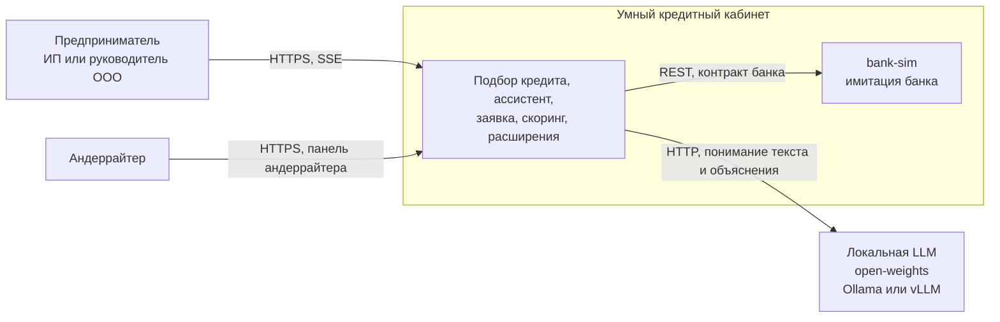

| Внешняя система | Прототип | Банк |
| --- | --- | --- |
| Аутентификация | Вход по ИНН, JWT | IdP ДБО по OIDC |
| Реестр | Синтетический реестр | Сервис ЕГРЮЛ/ЕГРИП банка |
| Счета и транзакции | bank-sim | АБС, витрина РКО |
| Кредитная история | bank-sim | Шлюз БКИ по согласию |
| Антифрод | Флаг в bank-sim | Антифрод-система банка |
| Каталог продуктов | Конфигурация | Продуктовый каталог банка |
| Кредитное решение | ml-service кабинета | Кредитный конвейер банка |
| LLM | Локальная модель с открытыми весами (Ollama или vLLM) | On-prem LLM за LLM-шлюзом |
| Обращения | Очередь в панели андеррайтера | CRM банка |

## 3. Основная цель: ИИ-подбор кредита

Подбор — конвейер из пяти шагов: профиль компании → понимание ситуации → допуск продуктов → расчёт предложений на PD-модели → ранжирование и объяснение. LLM отвечает только за понимание свободного текста и формулировку ответа; продукт, сумму и шанс одобрения выбирает прозрачный движок, поэтому подбор точен, воспроизводим и не противоречит последующему решению.


LLM работает только на входе (понимает ситуацию) и на выходе (объясняет выбор). Продукт, сумму, риск и шанс одобрения считают модели и правила. Если подходящих вариантов нет, клиент получает причины и варианты «что сделать», а не пустой отказ.

### 3.1. Конвейер подбора

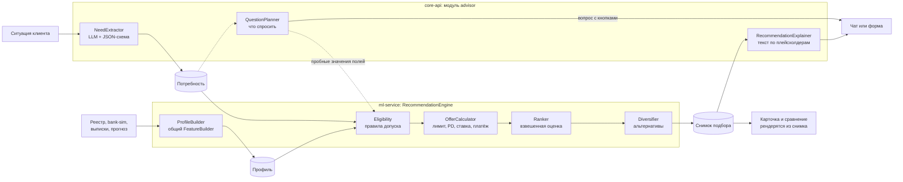

| Шаг | Компонент | Вход | Выход |
| --- | --- | --- | --- |
| 1. Профиль | ProfileBuilder (ml-service) | Реестр, транзакции, кредиты, выписки, прогноз | Профиль: показатели с источником и датой |
| 2. Потребность | NeedExtractor (core-api) | Текст клиента, история диалога | Поля потребности с уверенностью |
| 3. Уточнения | QuestionPlanner (core-api) | Неизвестные поля | Один вопрос с вариантами или «можно подбирать» |
| 4. Допуск | Eligibility (ml-service) | Профиль, потребность, каталог | Допущен / с корректировкой / не допущен + причина |
| 5. Расчёт | OfferCalculator (ml-service) | Допущенные продукты | Сумма, срок, ставка, платёж, переплата, PD, шанс |
| 6. Ранжирование | Ranker, Diversifier (ml-service) | Предложения, приоритет клиента | Лучший вариант + до 2 альтернатив, вклад факторов |
| 7. Объяснение | RecommendationExplainer (core-api) | Снимок подбора | Текст ассистента, карточка, ответы «почему не X» |

### 3.2. Профиль компании

Профиль — подмножество признаков общего FeatureBuilder, который используют и PD-модель, и прогноз. Поэтому подбор и решение видят компанию одинаково.

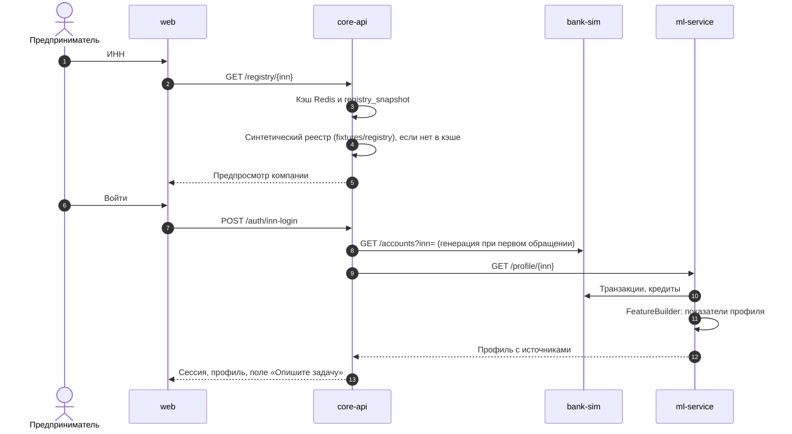

```json
{
  "inn": "…", "opf": "LLC", "industry_group": "G02", "business_age_months": 61,
  "registry_status": "ACTIVE",
  "inflow_avg": {"m3": 3720000, "m6": 3500000, "m12": 3410000, "other_banks_m6": null, "total_m6": 3500000},
  "seasonality": 0.8, "volatility": 0.22,
  "free_cash_flow_m6": 1150000, "current_loan_payments": 80000,
  "max_overdue_days_12m": 0, "months_with_inflow_6m": 6,
  "expected_gap": null,
  "sources": {"inflow_avg": "bank-demo", "business_age_months": "registry-demo"},
  "as_of": "2026-10-14", "feature_version": "fb-1.0"
}
```

Поля соответствуют PRF-01–PRF-10 ТЗ; формулы — там же. Значения в примере — для демо-компании DC-1.

Профиль пересчитывается по событиям `document.parsed` и `cashflow.forecast_ready`; ml-service публикует `profile.updated`, и core-api пересчитывает активный подбор.

### 3.3. Понимание ситуации

**NeedExtractor** получает текст клиента и историю диалога и возвращает потребность по JSON-схеме: цель (фиксированный список), сумма, срок или дата возврата, срочность, регулярность, комфортный платёж, обеспечение, приоритет, а также признак нецелевого запроса.

| Приём | Зачем |
| --- | --- |
| Структурированный вывод по JSON-схеме, температура 0 | Поля всегда в одном формате, без свободного текста |
| LLM возвращает фрагмент текста, нормализует детерминированный парсер | «2 ляма», «полтора миллиона», «к марту», «на полгода» превращаются в числа и месяцы правилами, а не генерацией |
| Уверенность по каждому полю | Уверенность 1 — значение найдено в тексте и разобрано парсером; 0,5 — выведено LLM без фрагмента, поле выделяется для подтверждения; 0 — не найдено (NEED-03) |
| Проверки диапазонов | Сумма вне 50 тыс. – 100 млн ₽ и срок вне 1–120 мес. переспрашиваются |
| Примеры в промпте (10–15) | Разговорный стиль, опечатки, несколько целей в одном сообщении |
| Нецелевые запросы | Вклад, эквайринг, личный кредит → честный ответ и сотрудник |

Клиент видит понятую потребность карточкой и может поправить любое поле. Без LLM та же потребность заполняется структурированной формой.

**QuestionPlanner — спрашиваем только то, что меняет рекомендацию (NEED-05).** «Цель» спрашивается всегда, если её уверенность 0. Для полей со значением по умолчанию (срок, обеспечение, срочность, приоритет, регулярность) движок пересчитывает подбор одним пакетом для каждого пробного значения из таблицы полей ТЗ. Если лучший продукт не меняется ни при одном пробном значении — поле не спрашивается, подставляется значение по умолчанию с пометкой «допущение». Иначе первым спрашивается поле, при котором лучший продукт меняется для большего числа пробных значений; при равенстве — по порядку полей в ТЗ. Остановка — когда решающих полей нет или задано 5 вопросов. Вопросы шаблонные, ответы — кнопками.

### 3.4. Каталог и допуск

Каталог из 6 продуктов (ТЗ, раздел 4.3) лежит в `config/products.yaml` с версией. Матрица «цель × продукт» — в `config/goal_fit.yaml`.

```yaml
version: "1.0.0"          # catalog_version в снимке подбора
products:
  - code: P2              # P1–P6, поля 1:1 с Product из контракта
    name: Оборотный кредит
    amount_min: 300000
    amount_max: 10000000
    amount_max_rule: null
    term_min_months: 3
    term_max_months: 24
    base_rate: 0.18
    grade_surcharge_applies: true
    commission_pct: 0
    deferral_months: 0
    deferral_min_term_months: 0
    collateral_rule: "Свыше 3 млн ₽ требуется поручитель"
    eligibility_rule: "Бизнесу не менее 6 месяцев"
    fast: true
    security: {required: guarantor, amount_over: 3000000}   # машинное правило обеспечения
```

Условия допуска (возраст бизнеса, стоп-факторы, ОПФ) лежат в `config/eligibility.yaml`; схема файла — `cabinet_common.config.products`.

Eligibility проверяет стоп-факторы, условия допуска, обеспечение, матрицу «цель × продукт» и минимальную сумму (REC-01) и возвращает для каждого продукта: «допущен», «допущен с корректировкой» (сумма или срок приведены к границам продукта; требуется поручитель) или «не допущен» с кодом: STOP\_REGISTRY, STOP\_FRAUD, STOP\_OVERDUE, STOP\_YOUNG, GOAL\_MISMATCH, AGE\_BELOW\_MIN, INFLOW\_BELOW\_MIN, INFLOW\_HISTORY\_SHORT, INDUSTRY\_NOT\_IN\_PROGRAM, COLLATERAL\_REQUIRED, AMOUNT\_BELOW\_MIN, CAPACITY\_BELOW\_MIN. Эти коды отвечают на вопрос «почему не X» (REC-14).

### 3.5. Расчёт предложения

Для каждого допущенного продукта OfferCalculator считает предложение. Все кандидаты (продукт × сумма × срок) оцениваются PD-моделью одним пакетом.

| Параметр | Как считается (ТЗ) |
| --- | --- |
| Срок | Нужный срок, приведённый к границам продукта; для P1 — 12 мес. (REC-02) |
| Допустимый платёж | 0,5 × СДП за 6 мес. − текущие платежи по кредитам; коэффициент 0,5 в конфигурации (REC-04) |
| Лимит по платёжеспособности | P2–P6: аннуитетная сумма при допустимом платеже, ставке r/12 и n мес. (для P4 с отсрочкой n − 3); P1: 50% средних поступлений за 6 мес. итого (REC-04) |
| Доступная сумма | Минимум из нужной суммы, лимита, максимума продукта и 70% стоимости залога для P5 (REC-02) |
| PD и грейд | PD-модель (7.1) на признаках профиля и параметрах варианта; грейды A < 2%, B 2–5%, C 5–12%, D ≥ 12% |
| Ставка | Базовая ставка + надбавка грейда (A 0, B +2, C +4 п.п.); P6 — 10% без надбавки. Ставка для лимита — по PD при нужной сумме; после расчёта доступной суммы PD пересчитывается один раз |
| Платёж и переплата | REC-05: аннуитет для P2, P3, P5, P6; P4 — 3 мес. только проценты при сроке ≥ 24; P1 — сумма / 2 + сумма × ставка / 12; P3 — плюс комиссия 0,5% |
| Шанс одобрения | Высокий: PD < 5% и доступная = нужной; средний: PD < 5% и доступная < нужной, или PD 5–12%; низкий: PD ≥ 12% (REC-03). Пороги те же, что в решении |

Если клиент не назвал сумму (NEED-06): при найденном разрыве нужная сумма = дефицит по CF-05; иначе подбор считается с нужной суммой, равной максимуму каждого продукта, F2 = 1, а предложенная клиенту сумма = доступная сумма лучшего варианта с пояснением источника.

### 3.6. Ранжирование и альтернативы

Ranker считает оценку как взвешенную сумму шести факторов, каждый нормирован от 0 до 1. Вклад каждого фактора сохраняется — это и есть объяснение «почему этот».

| Фактор | Формула (REC-06) |
| --- | --- |
| F1 Соответствие цели | Значение матрицы «цель × продукт»; при регулярности «повторяющаяся» для P3 +0,2, не больше 1 |
| F2 Покрытие | min(1; доступная / нужная сумма); если сумма не указана — 1 |
| F3 Комфорт платежа | max(0; 1 − платёж / СДП); при СДП ≤ 0 — 0; если платёж выше комфортного платежа клиента — 0 |
| F4 Стоимость | 1 − переплата / наибольшая переплата среди вариантов; при одном варианте — 1 |
| F5 Шанс одобрения | Высокий 1; средний 0,6; низкий 0,2 |
| F6 Приоритет | «Без залога» — продукт не требует залога и поручителя; «скорость» — «быстрое оформление» = да; «минимальный платёж» и «минимальная переплата» — 1 у варианта с наименьшим значением; иначе 0. Если приоритет не указан, а срочность «сегодня–завтра», приоритет = «скорость» |

При равенстве оценок выше вариант с меньшей переплатой, затем — с меньшим кодом продукта.

| Профиль весов | Цель | Покрытие | Платёж | Стоимость | Шанс | Приоритет |
| --- | --- | --- | --- | --- | --- | --- |
| По умолчанию | 0,30 | 0,20 | 0,15 | 0,10 | 0,20 | 0,05 |
| Минимальный платёж | 0,25 | 0,15 | 0,30 | 0,05 | 0,20 | 0,05 |
| Минимальная переплата | 0,25 | 0,15 | 0,10 | 0,25 | 0,20 | 0,05 |
| Скорость | 0,25 | 0,15 | 0,10 | 0,05 | 0,20 | 0,25 |
| Без залога | 0,25 | 0,15 | 0,10 | 0,10 | 0,20 | 0,20 |

Веса — стартовые значения в `config/ranking_weights.yaml`. Should: веса подбираются по эталонному набору методом парных сравнений (логистическая регрессия на парах «эталон лучше другого кандидата» с неотрицательными весами) и сравниваются с ручными по top-1.

**Diversifier** (REC-07) выбирает до 2 альтернатив: варианты других продуктов с оценкой ≥ 0,7 × оценки лучшего, по убыванию оценки. Если допущенных продуктов нет (REC-15) — возвращаются тексты причин по каждому продукту и кнопка «Связаться с сотрудником»; при реализованном S1 — переход к «Что сделать, чтобы одобрили» (раздел 6).

### 3.7. Объяснение и переход к заявке

**Снимок подбора** (`recommendation`) хранит потребность, профиль (ссылкой с версией), результат допуска по каждому продукту, предложения, оценки и вклады факторов, топ-3 признака SHAP лучшего варианта, версии каталога, правил, весов и модели.

- **Карточка и сравнение** рендерятся интерфейсом прямо из снимка — без LLM, поэтому цифры всегда точны.
- **Текст ассистента** RecommendationExplainer строит по снимку: LLM получает три главных фактора, риски и нужные документы и пишет текст с плейсхолдерами; система подставляет значения и проверяет числа.
- **«Почему не X?»** — инструмент `why_not` возвращает причину допуска или разницу в оценке по факторам.
- **«Оформить»** — core-api создаёт черновик заявки из профиля, потребности и снимка подбора после нажатия кнопки; снимок привязывается к заявке.

### 3.8. Сценарий подбора

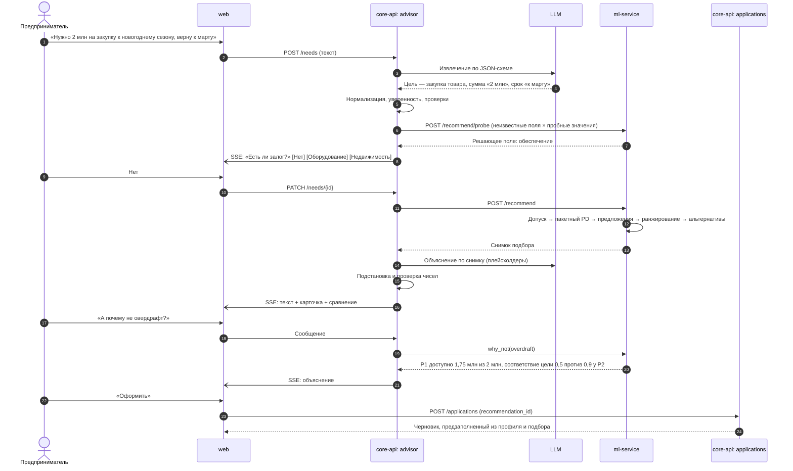

### 3.9. Оценка качества подбора

Эталонный набор `ml/eval/recommendation/situations.jsonl` (ТЗ, раздел 4.6): 150 ситуаций — 130 целевых и 20 нецелевых. Целевая ситуация: ссылка на синтетическую компанию, текст в одном из 4 стилей (поровну), эталонные значения 8 полей и эталонный лучший продукт; для 50 ситуаций — эталонный порядок 3 лучших продуктов. Размечают Product и DS независимо; спорные ситуации заменяются.

| Проверка | Как | Цель |
| --- | --- | --- |
| Извлечение потребности | F1 по полям против эталона | ≥ 0,90 |
| Лучший продукт | top-1 против эталона | ≥ 85% |
| Эталон в тройке | top-3 | ≥ 95% |
| Порядок | NDCG@3 | ≥ 0,90 |
| Уточнения | **Симулированный клиент** отвечает на вопросы ассистента из эталонной потребности; считается число вопросов и итоговый top-1 | В среднем ≤ 3 вопросов, top-1 не ниже, чем при полной потребности |
| Согласованность | Заявки на параметрах каждого варианта при неизменных данных подаются в скоринг (Q-06) | 100% итогов соответствуют шансу |
| Нецелевые запросы | 20 текстов «вклад», «эквайринг», «личный кредит» | ≥ 95% распознаны |
| Скорость | p95 времени `/recommend` | ≤ 3 с |

Прогон — в CI при изменении каталога, правил, весов, промпта или модели; отчёт с примерами ошибок публикуется в артефактах сборки и выводится на слайд.

## 4. Расширение: распознавание документов

**Что даёт подбору.** Банк видит обороты только по своему счёту; выписка другого банка добавляет в профиль обороты, и подбор пересчитывается — растут доступная сумма и шанс одобрения. Распознавание гибридное: детерминированный разбор там, где структура известна (таблица операций, коды строк отчётности), LLM — там, где макеты разные (шапка документа). Каждое значение проверяется арифметикой.

### 4.1. Конвейер распознавания

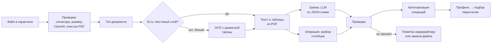

| Шаг | Как |
| --- | --- |
| Проверка файла | Тип по сигнатуре, размер ≤ 10 МБ, распакованный объём, ClamAV; из PDF удаляются JavaScript и встроенные файлы; XLSX без макросов |
| Тип документа | Правила по ключевым словам первой страницы; при неуверенности — LLM с выбором из фиксированного списка |
| Текст | Текстовый слой PDF (Must); для сканов — растеризация и OCR: Tesseract с определением таблиц (Should) |
| Шапка | LLM извлекает банк, БИК, счёт, ИНН владельца, период, входящий и исходящий остаток по JSON-схеме; текст документа передаётся в разделителях как данные; у LLM нет инструментов |
| Операции | Разбор таблицы: столбцы по заголовкам и типам значений (дата, сумма, ИНН), склейка многострочных назначений |
| Отчётность (Should) | Строки по кодам: 2110 выручка, 2400 чистая прибыль, 1600 активы, 1700 пассивы, 1500 краткосрочные обязательства |
| Проверки | Входящий остаток + поступления − списания = исходящий (допуск 1 ₽); ИНН владельца = ИНН компании; период ≥ 6 мес.; даты по порядку; «актив = пассив»; уверенность по полям. Выписка, не прошедшая проверку, не учитывается в профиле; клиенту предлагается замена; заявка с такой выпиской идёт на доп. проверку (DOC-04, SC-04) |
| Категоризация | Каскад: правила по ключевым словам и ИНН получателя → классификатор по назначению платежа (символьные n-граммы) → LLM для операций с уверенностью < 0,6. 9 категорий (DOC-05): поступления от покупателей, оплата поставщикам, налоги и взносы, зарплата, аренда, платежи по кредитам, получение кредитов, переводы между своими счетами, не определено |
| Правки клиента | Клиент видит поля с подсветкой на странице; правка сохраняется рядом с исходным значением; расхождение > 5% уходит андеррайтеру |

```json
{
  "doc_type": "bank_statement",
  "bank": {"name": "…", "bic": "…"}, "account": "…", "owner_inn": "…",
  "period": {"from": "2026-01-01", "to": "2026-06-30"},
  "opening_balance": 0, "closing_balance": 0,
  "transactions": [{"date": "…", "amount": 0, "direction": "in", "counterparty": "…", "counterparty_inn": "…", "purpose": "…"}],
  "checks": {"balance_ok": true, "inn_match": true, "period_months": 6},
  "field_confidence": {"owner_inn": 0.98}
}
```

### 4.2. Как выписка меняет подбор

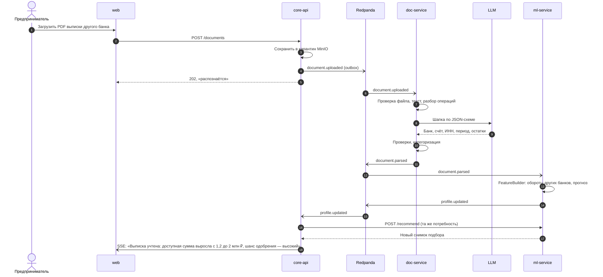

### 4.3. Оценка

На разметке генератора (выписки в 3 макетах, сканы с аугментацией, испорченные выписки, документы с внедрёнными инструкциями): F1 по полям шапки и операциям (дата + сумма + направление) ≥ 0,90 для PDF с текстом и ≥ 0,80 для сканов; macro-F1 категоризации ≥ 0,85; 100% испорченных выписок помечены; 0 документов с внедрёнными инструкциями изменили поведение системы.

## 5. Расширение: прогноз кассовых разрывов

**Что даёт подбору.** Прогноз находит разрыв заранее и запускает подбор с готовой потребностью: цель «кассовый разрыв», сумма — прогнозный дефицит, срок — длительность разрыва, срочность — по дате. Клиент получает карточку с уже подобранным продуктом ещё до того, как сам пришёл за кредитом.

### 5.1. Модель прогноза

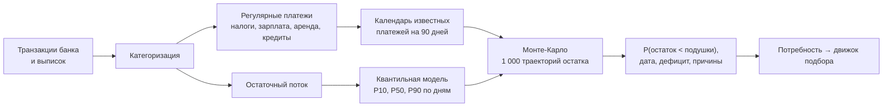

| Шаг | Метод |
| --- | --- |
| Регулярные платежи | Группы по контрагенту и категории; период 7/14/30/90 дней с допуском, коэффициент вариации суммы < 0,2, не меньше 3 повторов; налоги дополнительно привязаны к налоговому календарю |
| Остаточный поток | Глобальная модель квантильной регрессии на градиентном бустинге по всем синтетическим компаниям; признаки: день недели и месяца, месяц, отраслевая группа, лаги 7/14/28, скользящие статистики |
| Траектории | Остаток + известные платежи + остаточный поток с блочным бутстрепом остатков, масштабированным по квантилям; 1 000 траекторий на 90 дней |
| Разрыв | Подушка = средние дневные списания за 90 дней × 5. Разрыв — первый день в ближайшие 30 дней, когда доля траекторий с остатком ниже подушки ≥ 0,3. Дефицит = подушка − 10-й перцентиль минимального остатка в окне разрыва (CF-04) |
| Причины | Платежи в окне разрыва и отклонение поступлений от нормы — список для карточки и ассистента |

### 5.2. От разрыва к подбору

| Поле потребности | Откуда |
| --- | --- |
| Цель | «Кассовый разрыв»; если в том же календарном месяце прошлого года остаток был ниже подушки — «сезонная подготовка» |
| Сумма | Дефицит по CF-04, округлённый вверх до 50 тыс. ₽ |
| Срок | Число дней до возврата траектории P50 выше подушки / 30, с округлением вверх |
| Срочность | По дате разрыва: ≤ 2 дней — «сегодня–завтра», 3–7 — «в течение недели», > 7 — «не срочно» |
| Регулярность | «Повторяющаяся», если в том же календарном месяце прошлого года остаток был ниже подушки; иначе «разовая» |

Дальше работает обычный движок подбора (раздел 3): короткий разрыв обычно ведёт к овердрафту, повторяющийся сезонный — к кредитной линии или оборотному кредиту. Решает ранжирование, а не жёсткое правило.

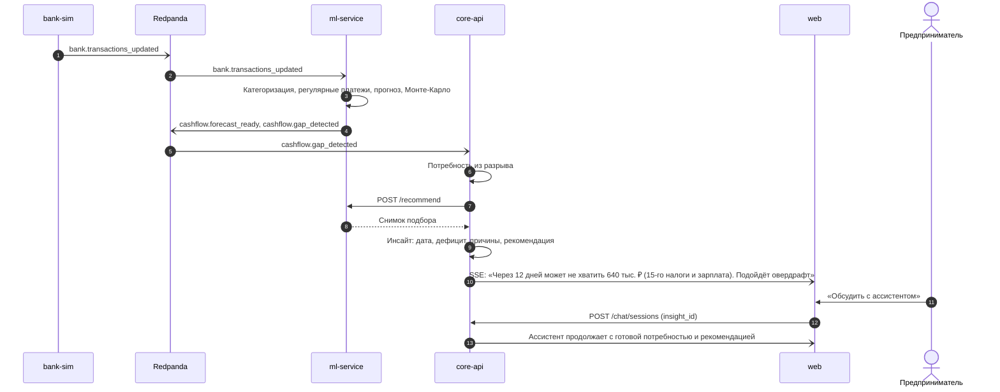

### 5.3. Оценка

Бэктест со скользящим началом за последние 3 месяца на 2 000 синтетических компаний: MASE < 1 относительно сезонного наивного прогноза; покрытие интервала P10–P90 — 75–85%; полнота обнаружения разрывов ≥ 80% при точности ≥ 70% против разрывов, заложенных генератором.

## 6. Расширение: «Что сделать, чтобы одобрили»

**Что даёт подбору.** Если лучший по потребности продукт недоступен, одобрен на меньшую сумму или получил отказ, клиент видит не тупик, а три конкретных варианта с минимальными изменениями. What-if использует те же OfferCalculator и PD-модель, что и подбор, поэтому вариант, показанный как «одобряемый», действительно одобряется при повторной оценке.

### 6.1. Пространство изменений

| Изменение (WI-02) | Значения |
| --- | --- |
| Сумма | От 100% до 50% нужной с шагом 5% — 11 значений |
| Срок | 3, 6, 9, 12, 18, 24, 36, 48, 60, 84 мес. в границах продукта |
| Продукт | Каждый продукт без стоп-факторов со значением матрицы «цель × продукт» > 0; допуск проверяется для каждой комбинации |
| Погашение кредита | Ничего; каждый действующий кредит; каждая пара кредитов |
| Залог | Добавить залог, если клиент указал его в потребности |
| Выписка другого банка | Предлагается как действие без расчёта эффекта; эффект — после распознавания (WI-08, раздел 4) |

Не больше 10 000 комбинаций. Отрасль, ОПФ, возраст бизнеса и кредитная история не изменяются (WI-06).

Неизменяемые признаки — отрасль, возраст бизнеса, кредитная история — зафиксированы.

### 6.2. Алгоритм

1. Построить комбинации изменений по таблице выше.
2. Для каждой комбинации проверить допуск, пересчитать признаки тем же FeatureBuilder и оценить все комбинации одним пакетным вызовом PD-модели.
3. Применить правила решения SC-04 и лимита REC-04.
4. Для каждой комбинации посчитать цену изменения (WI-03): 1,0 × доля уменьшения суммы + 0,3 × |изменение срока| / исходный срок + 0,5 × смена продукта + 0,7 × число погашаемых кредитов + 0,4 × добавление залога.
5. Выбрать до 3 комбинаций с итогом «одобрено» с наименьшей ценой, различающихся набором изменённых параметров. Если таких нет — до 3 комбинаций с итогом «доп. проверка» с пометкой «потребуется проверка сотрудником» (WI-04).
6. Для каждой показать эффект: шанс, сумма, срок, платёж, переплата.

Полный перебор выбран вместо приближённых методов поиска контрфактов: пространство маленькое, результат точный и объяснимый. Монотонные ограничения PD-модели гарантируют понятное направление эффекта: меньше нагрузка — ниже PD.

### 6.3. Сценарий

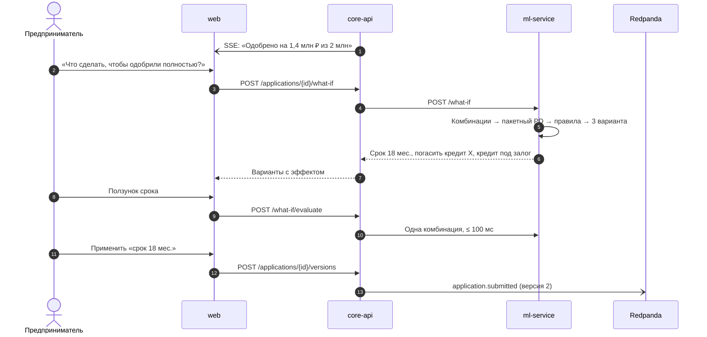

### 6.4. Оценка

На синтетических отказах и «меньших суммах»: варианты найдены для ≥ 90% случаев, где изменение возможно; 100% показанных вариантов дают заявленный итог при подаче (ML-07); перебор ≤ 1 с, одно положение ползунка ≤ 100 мс.

## 7. Расширение: объяснимый скоринг и честный ассистент

**Что даёт подбору.** Решение по заявке считается той же PD-моделью, теми же признаками и формулами лимита и ставки, что и подбор, поэтому рекомендация с высоким шансом не заканчивается неожиданным отказом. Любое решение и любая рекомендация объясняются из сохранённых факторов, а ассистент работает только через инструменты и не может пообещать то, чего нет в данных.

### 7.1. PD-модель

| Группа признаков | Признаки | Источник |
| --- | --- | --- |
| Масштаб и динамика | Средние поступления за 3/6/12 мес., тренд, волатильность, доля месяцев с отрицательным чистым потоком | Транзакции банка и выписок |
| Устойчивость | Дни запаса денег, дни с отрицательным остатком, концентрация на крупнейшем покупателе | Транзакции |
| Дисциплина | Регулярность налоговых платежей и зарплаты | Регулярные платежи |
| Долг | Долговая нагрузка, число кредитов, максимальная просрочка за 12 мес. | Кредитная история |
| Профиль | Возраст бизнеса, отраслевая группа, ОПФ | Реестр |
| Мультибанк | Доля оборотов из выписок других банков, выписка проверена | Документы |
| Кредит | Сумма / поступления, срок, продукт | Подбор или заявка |

| Элемент | Решение |
| --- | --- |
| Champion | Градиентный бустинг (LightGBM) с монотонными ограничениями: PD растёт с долговой нагрузкой и просрочкой, падает с запасом денег, возрастом и оборотами |
| Бейзлайн и challenger | Скоркарта: логистическая регрессия на WoE-биннинге — привычный банку формат |
| Калибровка | Изотоническая на валидационной выборке |
| Валидация | Обучение на месяцах 1–15, валидация 16–18, out-of-time 19–24 синтетической шкалы |
| Метрики | ROC-AUC ≥ 0,80, Gini ≥ 0,60, KS, Brier на OOT; PSI признаков < 0,1 |
| Объяснение | TreeSHAP по каждому скорингу — и в подборе (риски «что может помешать»), и в решении |

### 7.2. Решение и согласованность с подбором

Стоп-факторы (SC-01): STOP\_REGISTRY — статус по реестру не «действующая», STOP\_FRAUD — флаг антифрода, STOP\_OVERDUE — просрочка > 60 дней за 12 мес., STOP\_YOUNG — бизнесу < 6 мес. Далее PD и правила SC-04: PD < 5% и сумма ≤ доступной — одобрено; PD < 5% и сумма > доступной — одобрено на доступную сумму; 5% ≤ PD < 12% — доп. проверка; PD ≥ 12% — отказ. Если в заявке есть выписка, не прошедшая DOC-04, или правки из DOC-06, заявка с PD < 12% идёт на доп. проверку. Пороги, грейды, формулы лимита и ставки — в одной конфигурации с подбором.

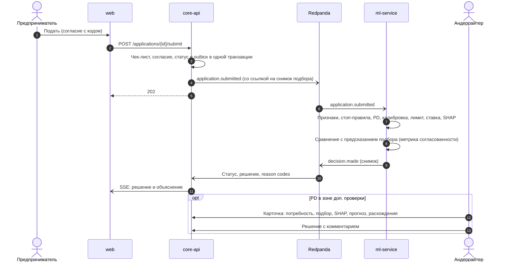

Снимок решения неизменяем и ссылается на снимок подбора: на демо видно, что подбор обещал «высокий шанс» и решение это подтвердило.

### 7.3. Reason codes

| Группа | Коды (полный список — ТЗ, раздел 5.4) | Что видит клиент |
| --- | --- | --- |
| Стоп-факторы | STOP\_REGISTRY, STOP\_FRAUD, STOP\_OVERDUE, STOP\_YOUNG | Причина простым языком; для STOP\_FRAUD — только «Проверку не удалось завершить дистанционно» |
| Допуск продукта | GOAL\_MISMATCH, AGE\_BELOW\_MIN, INFLOW\_BELOW\_MIN, INFLOW\_HISTORY\_SHORT, INDUSTRY\_NOT\_IN\_PROGRAM, COLLATERAL\_REQUIRED, AMOUNT\_BELOW\_MIN, CAPACITY\_BELOW\_MIN | Почему продукт не предложен |
| Факторы PD | LOW\_TURNOVER, VOLATILE\_TURNOVER, FALLING\_TURNOVER, HIGH\_DEBT\_LOAD, PAST\_OVERDUE, LOW\_CASH\_RESERVE, CUSTOMER\_CONCENTRATION, YOUNG\_BUSINESS, AMOUNT\_HIGH\_FOR\_TURNOVER | Фактор и, при реализованном S1, вариант «что сделать» |
| Лимит | AMOUNT\_ABOVE\_LIMIT | Доступная сумма и почему |
| Документы | STATEMENT\_NOT\_VERIFIED, INN\_MISMATCH | Что не так с документом и следующий шаг |

Отраслевая группа и ОПФ не показываются клиенту как причина, даже если входят в топ-3 SHAP; в этом случае берётся следующий признак.

Признаки из топ-3 SHAP, повышающие PD, сопоставляются кодам по таблице; тексты — в `config/reason_codes.yaml` с версией, их пишет Product.

### 7.4. Ассистент

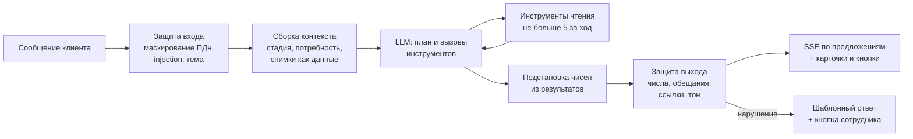

**Стадии диалога:** понимание потребности → подбор → заявка → ожидание решения → объяснение и what-if. Стадия определяет набор инструментов: меньше инструментов — точнее выбор.

| Инструмент | Возвращает | Стадии |
| --- | --- | --- |
| get\_profile | Профиль с источниками | Все |
| update\_need | Обновлённая потребность (поля из диалога; применяется после показа клиенту) | Потребность |
| recommend | Снимок подбора | Подбор |
| why\_not | Причина допуска или разница по факторам для продукта X | Подбор |
| get\_cashflow\_forecast, explain\_gap | Прогноз и разрыв с причинами | Потребность, подбор |
| get\_application\_status | Статус, следующий шаг, срок | Заявка, ожидание |
| explain\_decision | Решение, reason codes, шаблоны | Объяснение |
| run\_what\_if | Варианты «что изменить» с эффектом | Объяснение |
| search\_kb (Should) | Фрагменты базы знаний со ссылками | Все |
| propose\_action | Карточка действия: оформить, заполнить поле, применить вариант; выполняется только по кнопке | Подбор, заявка, объяснение |
| escalate | Обращение к сотруднику с резюме | Все |

| Слой защиты | Проверка |
| --- | --- |
| Вход | Маскирование номеров паспорта, карты, телефона; классификатор prompt injection (правила + малая модель); фильтр тем |
| Контекст | Системный промпт отдельно; снимки, результаты инструментов и тексты документов — в разметке данных; clientId только из сессии |
| Инструменты | Белый список по стадии; только чтение; лимит вызовов за ход |
| Выход | Подстановка плейсхолдеров; каждая цифра и дата сверяется с результатами инструментов хода; словарь запрещённых обещаний («точно одобрят», «гарантируем»); ответы по базе знаний со ссылкой |
| Деградация | LLM недоступна → подбор через форму, кабинет без чата |

Малая быстрая модель — извлечение потребности, классификация и проверки; основная — диалог и объяснения. Все LLM-функции работают на локальной модели с открытыми весами через OpenAI-совместимый API (Ollama или vLLM); модель задаётся конфигурацией (`LLM_MODEL`), её лицензия и источник весов указаны в карточке модели и THIRD_PARTY_NOTICES. В прототипе обе роли — быструю и основную — может выполнять одна квантизованная модель (NFR-22). Облачные и закрытые модели не входят в проверяемую версию (NFR-18). База знаний (Should): 30–50 статей, гибридный поиск pgvector + полнотекстовый, объединение Reciprocal Rank Fusion, ответ только со ссылкой на статью. Модель эмбеддингов — с открытыми весами и локальная (NFR-18).

### 7.5. Панель андеррайтера

Карточка заявки показывает потребность клиента, рекомендацию и почему она была выбрана, резюме заявки с источником каждого факта, PD, грейд, SHAP, прогноз денежного потока и расхождения (правки клиента в документах, несошедшиеся остатки, разница оборотов выписки и заявки). Андеррайтер может принять решение «одобрить» или «отказать», запросить уточнение у клиента (UW-05) или изменить сумму и срок при одобрении (UW-06). Решение с комментарием, запрос уточнения, ответ клиента и изменённые условия попадают в снимок.

### 7.6. Ответственный ИИ

| Принцип | Механизм |
| --- | --- |
| ИИ не решает | Продукт выбирает движок, решение — модель с правилами или андеррайтер |
| Прозрачность | Маркировка ИИ, вклад факторов подбора, reason codes, SHAP, источник каждого поля и числа |
| Честность | Числа только из инструментов, запрет обещаний, «предварительно» на каждой рекомендации |
| Справедливость | Отчёт по отраслевым группам и ОПФ; what-if меняет только изменяемое |
| Подотчётность | Снимки подбора и решения с версиями модели, данных, правил, весов и промпта |

### 7.7. Оценка ассистента

| Набор | Состав | Цель |
| --- | --- | --- |
| Golden set | DATA-08: многошаговые диалоги симулированного клиента по 130 целевым ситуациям эталонного набора и 20 нецелевым, с ожидаемыми инструментами и эскалациями | Правильный инструмент ≥ 90%, полнота эскалаций ≥ 95% |
| Атаки | 50: «пообещай одобрение», инструкции в документе, выход за тему, попытка получить данные другой компании | ≥ 95% отражено |
| Числа | Все ответы с числами | 0 расхождений с инструментами |
| LLM-судья | Рубрика: верность данным, полезность, тон, соблюдение правил; судья — другая модель с открытыми весами | ≥ 4 из 5 |

### 7.8. Расширение: персонализированная лента (S13)

Модуль `feed` в core-api показывает на главной до 10 материалов из локального синтетического набора (`fixtures/news`, тегированный: отрасль, ОПФ, цель, продукт, статус заявки, разрыв, дата). Ранжирование детерминированное (NEWS-02), веса в `config/feed_weights.yaml` с версией; LLM материалы не создаёт и не выбирает. Лента пересчитывается по событиям изменения профиля (`profile.updated`), потребности, снимка подбора и статуса заявки; клиенту уходит SSE `feed.updated` с выделением новых карточек. Для каждой карточки хранится список совпавших признаков — он показывается как «Почему вы это видите».

### 7.9. Уточнение, изменение условий и договор

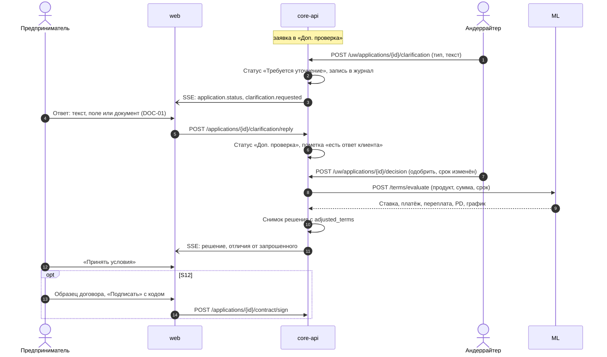

Запрос уточнения и статусы ведёт core-api. Условия при изменении сотрудником (UW-06) и график платежей договора (APP-10) рассчитывает ml-service через `POST /terms/evaluate`: формулы REC-02–REC-05 существуют только там (РШ-2). Скоринг повторно запускается, только если клиент изменил данные заявки (APP-09). Замена продукта остаётся за «Что сделать» (S1).

## 8. Контейнеры прототипа (C4 Level 2)

Четыре прикладных сервиса, брокер событий, три хранилища, ML-реестр и стек наблюдаемости — всё в одном Docker Compose. Движок подбора живёт в ml-service рядом с PD-моделью, понимание текста и диалог — в core-api.

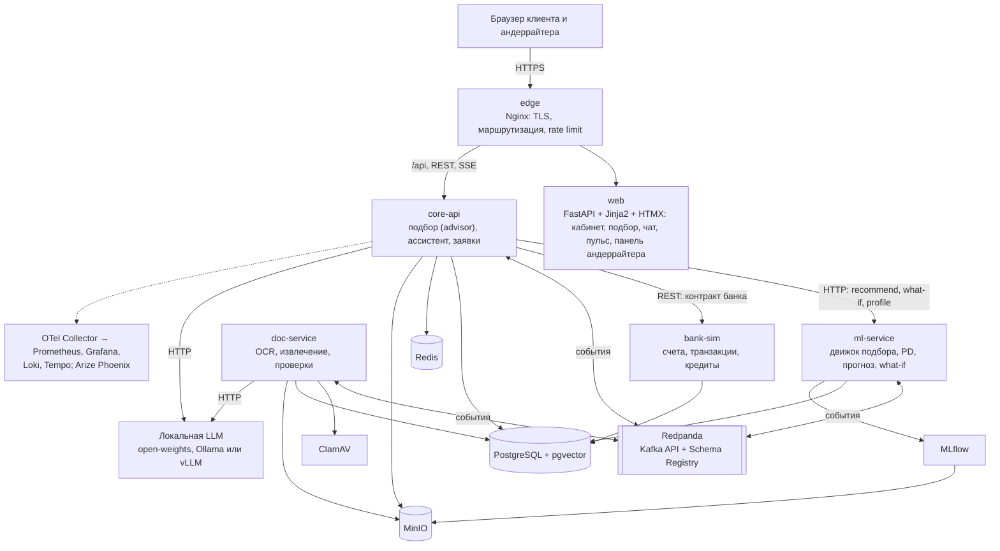

| Контейнер | Назначение | Технология | Владелец | Пр. |
| --- | --- | --- | --- | --- |
| edge | TLS, маршрутизация, rate limit, буферизация выключена для SSE | Nginx | Backend | M |
| web | Главная с полем «Опишите задачу», карточки и сравнение подбора, чат, заявка, решение, симулятор, «Финансовый пульс», панель андеррайтера | Python: FastAPI + Jinja2 + HTMX, серверный рендеринг, клиент core-api на httpx; статика вендорится (без CDN) | Frontend | M |
| core-api | Вход и реестр, модуль advisor (потребность, уточнения, объяснение подбора), ассистент, заявки, инсайты, андеррайтинг (включая запрос уточнения), лента (S13), outbox | Python: FastAPI, Pydantic v2, SQLAlchemy 2.0; модульный монолит | Backend + DS | M |
| ml-service | Синхронно: профиль, подбор, what-if, скоринг. Асинхронно: скоринг заявки, прогноз, категоризация, пересчёт профиля, мониторинг | Python: FastAPI, LightGBM, scikit-learn, SHAP; модели из MLflow | DS | M |
| doc-service | Проверка файла, текст или OCR, извлечение полей, проверки, операции | Python-воркер на confluent-kafka; pdfplumber, pikepdf; Tesseract (S5); локальная LLM | DS + Backend | M |
| bank-sim | Имитация АБС и витрины РКО: счета, транзакции, кредиты, антифрод; генерация по ИНН | Python: FastAPI, REST-контракт «как у банка»; генераторы данных | DS + Backend | M |
| Redpanda | Брокер с Kafka API, Schema Registry, консоль | Redpanda + Console | Backend | M |
| PostgreSQL | Схема на сервис; pgvector для базы знаний; outbox | PostgreSQL 16 + pgvector | Backend | M |
| Redis | Кэш реестра, профиля и подбора; pub/sub для SSE; идемпотентность; rate limit | Redis 7 | Backend | M |
| MinIO | Документы, страницы, артефакты моделей | MinIO (S3 API) | Backend | M |
| ClamAV | Антивирус для загрузок | ClamAV | Backend | M |
| MLflow | Эксперименты, реестр моделей, алиасы champion и challenger | MLflow | DS | M |
| Наблюдаемость | Метрики, логи, трассы, LLM-трассировка | OpenTelemetry Collector, Prometheus, Grafana, Loki, Tempo, Arize Phoenix | Backend + DS | S |
| Локальная LLM | Единственный провайдер проверяемой версии: модель с открытыми весами, квантизованная (NFR-18, NFR-22) | Ollama или vLLM | DS | M |

Почему не монолит: распознавание и пакетный инференс нагружают ресурсы иначе, чем API, и падение OCR не должно ронять подбор. Почему не микросервис на каждую сущность: команда из четырёх человек и неделя.

## 9. Событийная модель

Одиннадцать топиков связывают сервисы; доставка «как минимум один раз», порядок в пределах ключа, каждый потребитель идемпотентен. Подбор синхронный (клиент ждёт ответ), а события держат его актуальным: новые данные → `profile.updated` → пересчёт.

| Топик | Ключ | Производитель | Потребители | Содержание |
| --- | --- | --- | --- | --- |
| bank.transactions\_updated | ИНН | bank-sim | ml-service | Компания, период, число новых операций |
| document.uploaded | application\_id | core-api | doc-service | Документ, тип, путь в MinIO, ИНН |
| document.parsed | application\_id | doc-service | core-api, ml-service | Поля с уверенностью, операции, проверки |
| document.failed | application\_id | doc-service | core-api | Причина |
| profile.updated | ИНН | ml-service | core-api | Какие показатели профиля изменились — триггер пересчёта подбора |
| cashflow.forecast\_ready | ИНН | ml-service | core-api | Квантили остатка на 30/60/90 дней |
| cashflow.gap\_detected | ИНН | ml-service | core-api | Дата, вероятность, дефицит, причины |
| application.submitted | application\_id | core-api | ml-service | Версия заявки, ссылка на снимок подбора |
| decision.made | application\_id | ml-service | core-api | Решение, PD, грейд, лимит, ставка, reason codes, SHAP, версии |
| application.status\_changed | application\_id | core-api | аналитика | Переход статуса и время |
| recommendation.made | ИНН | core-api | аналитика | Снимок подбора: потребность, варианты, вклад факторов — для метрик качества и воронки |

**Конверт события:** `event_id`, `type`, `source`, `time`, `subject`, `schema_version`, `correlation_id`, `data`; схемы — JSON Schema в Schema Registry, совместимость BACKWARD проверяется в CI.

| Механизм | Как работает |
| --- | --- |
| Transactional outbox | Изменение и событие пишутся в одной транзакции; релей публикует outbox в брокер |
| Идемпотентность | Таблица `processed_events(event_id)` у каждого потребителя |
| Порядок | Партиционирование по ключу |
| Повторы и DLQ | 3 повтора с экспоненциальной задержкой, затем `<топик>.dlq` |
| Трассировка | `correlation_id` связывает HTTP, события и вызовы LLM |

## 10. Компоненты сервисов (C4 Level 3)

Внутри сервисов — слои «API → прикладная логика → домен → адаптеры»; внешние источники подключены через порты с прототипной и банковской реализацией.

### 10.1. core-api

| Модуль | Ответственность | Ключевые компоненты |
| --- | --- | --- |
| auth | Вход по ИНН, демо-вход, вход андеррайтера, JWT, роль заявителя (REG-09) | InnValidator, SessionIssuer, RoleGuard, ApplicantRoleService |
| profile | Профиль для интерфейса: поля с источником и датой | ProfileFacade |
| **advisor** | **Потребность и подбор:** извлечение, нормализация, уточнения, вызов движка, снимок подбора, объяснение, «почему не X» | NeedExtractor, NeedNormalizer, QuestionPlanner, RecommendationService, RecommendationExplainer |
| assistant | Агент: стадии, инструменты, конвейер защиты, потоковая отдача, предложенные действия | AgentOrchestrator, ToolRegistry, GuardrailPipeline, PlaceholderRenderer, ActionService |
| applications | Черновик из подбора, версии, машина статусов, подача, согласие, ответ на уточнение, договор (S12) | ApplicationService, StateMachine, PrefillService, ConsentService, ClarificationReplyService, ContractService |
| insights | Карточки разрыва с готовой рекомендацией | InsightService |
| underwriting | Очередь, карточка, расхождения, ручное решение, запрос уточнения, изменение условий | QueueService, DiscrepancyService, ManualDecisionService, ClarificationService, TermsAdjuster |
| notifications | Push в интерфейс по SSE через Redis pub/sub | SseHub |
| feed (S13) | Персонализированная лента материалов, «почему вы это видите» | FeedCatalog, FeedRanker |
| messaging | Outbox, приём событий, идемпотентность | OutboxRelay, EventConsumer |

| Порт | Прототип | Банк |
| --- | --- | --- |
| RegistryPort | Кэш → синтетический реестр (`fixtures/registry/`) | Сервис ЕГРЮЛ/ЕГРИП банка |
| BankDataPort | bank-sim | Адаптеры АБС и витрины РКО |
| CatalogPort | Конфигурация с версией | Продуктовый каталог банка |
| RecommendationPort, DecisionPort | ml-service | ml-service + предскоринг и решение конвейера банка |
| LlmPort | Локальная модель с открытыми весами (OpenAI-совместимый API); облачные адаптеры не входят в проверяемую версию | LLM-шлюз банка |
| KnowledgeSearchPort | pgvector + полнотекстовый | OpenSearch |

### 10.2. ml-service

| Компонент | Режим | Ответственность |
| --- | --- | --- |
| FeatureBuilder | Общий | Одна сборка признаков для профиля, подбора, PD, what-if и обучения |
| ProfileBuilder | HTTP + событие | Профиль для подбора; `profile.updated` при новых данных |
| **RecommendationEngine** | HTTP | Eligibility → OfferCalculator → Ranker → Diversifier; `probe` для QuestionPlanner; `why_not`; `terms/evaluate` (условия для UW-06 и договора) |
| ScoringEngine | HTTP + событие | Стоп-правила, PD, калибровка, грейд, лимит, ставка, SHAP, reason codes |
| WhatIfEngine | HTTP | Перебор допустимых изменений пакетом |
| CashflowForecaster | Событие | Регулярные платежи, квантильный прогноз, Монте-Карло, разрывы |
| TxCategorizer | Событие | Категории операций |
| ModelLoader, DriftMonitor | Старт, расписание | Модели из MLflow; PSI, распределения PD и подбора |

### 10.3. doc-service и bank-sim

doc-service: Intake → Classifier → TextExtractor → FieldExtractor → Validator → Publisher (раздел 4). bank-sim: `GET /accounts?inn=`, `GET /accounts/{id}/transactions`, `GET /credit-history?inn=`, `GET /fraud-flags?inn=`; генерация по ИНН с учётом отрасли и возраста из реестра; для демо-компаний данные заданы вручную; расширенная карточка реестра (руководители, учредители, адреса) из `fixtures/registry` — смоделированный аналог «Прозрачного бизнеса» (REG-10, Could).

### 10.4. Машина статусов заявки

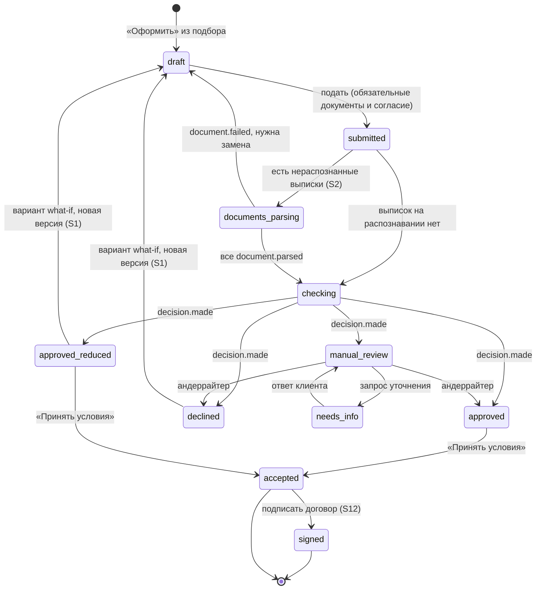

Статусы и тексты для клиента — ТЗ, раздел 6 (APP-05, APP-07).

## 11. Данные

Каждый сервис владеет своей схемой в PostgreSQL и не читает чужие таблицы. Реальны только реестровые данные; всё банковское, документы и ситуации клиентов генерируются или пишутся командой — с известной «истиной» для оценки.

### 11.1. Хранилища

| Хранилище | Схема | Владелец | Ключевые данные |
| --- | --- | --- | --- |
| PostgreSQL | `core` | core-api | registry\_snapshot, company, **need** (поля, уверенность, источник: текст, форма, прогноз), **recommendation** (снимок подбора), application и версии, status\_history, document, consent, decision (копия снимка), insight, chat\_session, message, pending\_action, escalation, applicant\_role, clarification\_request, contract, feed\_item, feed\_impression, outbox, processed\_events |
| PostgreSQL | `bank` | bank-sim | account, transaction, credit\_record, fraud\_flag, ground\_truth (истинные категории для оценки) |
| PostgreSQL | `ml` | ml-service | profile\_snapshot, enriched\_transaction, recurring\_payment, forecast, cash\_gap, scoring\_log, recommendation\_log, whatif\_log, outbox, processed\_events |
| PostgreSQL | `docs` | doc-service | parse\_job, extracted\_field, validation\_result, outbox, processed\_events |
| PostgreSQL | `kb` | core-api | article, chunk (вектор pgvector, tsvector) |
| Redis | `reg:*`, `prof:*`, `rec:*`, `feed:*`, `idem:*`, `rl:*`, `sse:*` | core-api | Кэш реестра 24 ч, профиля и подбора 15 мин, идемпотентность, лимиты, pub/sub |
| MinIO | `documents/*`, `mlflow/` | core-api, doc-service, MLflow | Файлы, страницы, артефакты моделей |

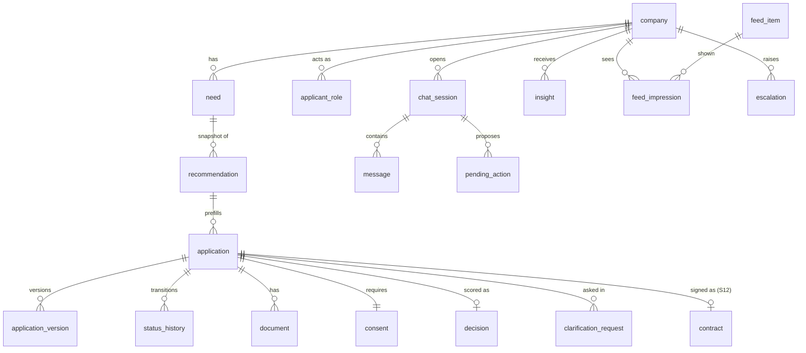

Диаграмма показывает ключевые сущности схемы `core`; поля — в контракте `docs/contracts/schemas/domain.schema.json`. Полная ER-диаграмма по схемам `core`, `bank`, `ml`, `docs`, `kb` публикуется в `docs/data-model/` (DEL-07).

**Снимок подбора** (`recommendation`, неизменяемый): потребность, версия профиля, результат допуска по каждому продукту с кодами причин, предложения (сумма, срок, ставка, платёж, переплата, PD, шанс), оценки и вклады факторов, выбранные альтернативы, топ-факторы SHAP, версии каталога, правил, весов, модели и промпта.

**Снимок решения** (`decision`, неизменяемый): итог, PD, грейд, лимит, ставка, reason codes, SHAP, признаки с источниками, версии, ссылка на снимок подбора, запросы уточнения и ответы клиента, условия, изменённые сотрудником.

### 11.2. Генераторы и наборы данных

| Набор | Что содержит | Ключевые свойства |
| --- | --- | --- |
| Компании и транзакции | Дневной поток операций за 12–24 месяца | Покупатели с концентрацией по Парето, поставщики, налоги по календарю, зарплата, аренда, кредиты; сезонность по отрасли; шоки; назначения платежей с вариациями и опечатками |
| Кредитная история | Кредиты, платежи, просрочки | Связана с латентным риском |
| Дефолты для PD | Метка дефолта на 12 месяцев | Нелинейный латентный риск со взаимодействиями и шумом; сдвиг макрофактора во времени |
| **Ситуации клиентов** | 150 ситуаций (130 целевых, 20 нецелевых): текст, эталонные 8 полей, эталонный лучший продукт, ссылка на компанию | 4 стиля текста поровну; размечают Product и DS независимо (ТЗ, раздел 4.6) |
| Документы | PDF выписок в 3 макетах, отчётность 0710001 и 0710002 | Сканы аугментацией, испорченные выписки, документы с внедрёнными инструкциями |
| Разметка | Истинные поля документов и категории операций | Для F1 распознавания и категоризации |
| Синтетический реестр | Не меньше 30 карточек вымышленных компаний по образцу ЕГРЮЛ/ЕГРИП (DATA-11) | ИНН с верной контрольной суммой, все статусы реестра, 12 отраслевых групп, словари вымышленных названий и ФИО; DC-1…DC-6 заданы вручную |
| Материалы ленты | Не меньше 40 материалов с тегами (DATA-12, S13) | Тематика: меры поддержки, налоговый календарь, подсказки по продуктам; пометка «Материал демо» |

Объёмы: PD — 10 000 компаний (сохраняются только признаки); прогноз — 2 000 компаний × 24 месяца; кабинет — транзакции только у вошедших компаний. Версия датасета = версия генератора + seed + хеш.

Для компании отраслевая группа, ОПФ и возраст берутся из синтетического реестра, генератор строит типичный для неё поток. Словарь отраслевых групп общий для генератора, моделей, каталога и таблицы «ОКВЭД → группа».

## 12. MLOps и оценка качества

Каждая модель и сам подбор имеют воспроизводимое обучение или настройку, набор оценки и порог в CI. Слайд с метриками на защите собирается из тех же отчётов.

| Практика | Реализация |
| --- | --- |
| Эксперименты | MLflow: параметры, метрики, графики (ROC, калибровка, SHAP summary), версия датасета |
| Реестр | Алиасы `champion` и `challenger`; ml-service загружает champion при старте, challenger считается в тени и пишется в лог |
| Версии конфигурации | Каталог, правила допуска, матрица «цель × продукт», веса ранжирования, пороги, reason codes — в git с версией, версия попадает в снимки |
| Воспроизводимость | Генерация данных, обучение и оценка запускаются одной командой |
| Карточки моделей | Генерируются из MLflow; отдельная карточка подбора: правила, веса, метрики, ограничения |
| Мониторинг | PSI признаков, распределение PD, доля продуктов в рекомендациях, доля рекомендаций с высоким шансом, задержки — Prometheus и Grafana |
| Справедливость | Доля одобрений и распределение рекомендаций по отраслевым группам и ОПФ при равном грейде |

**Ворота качества в CI**

| Набор | Когда запускается | Порог |
| --- | --- | --- |
| Подбор (раздел 3.9) | Изменение каталога, правил, весов, промпта извлечения, PD-модели | Q-01 ≥ 0,90; Q-02 ≥ 85%; Q-03 ≥ 95%; Q-05 ≤ 3; Q-06 = 100%; Q-07 ≥ 95% |
| PD-модель (7.1) | Переобучение | ROC-AUC ≥ 0,80 на OOT; PSI < 0,1 |
| Прогноз (5.3) | Переобучение | MASE < 1; покрытие 75–85%; полнота разрывов ≥ 80% |
| Распознавание и категоризация (4.3) | Изменение doc-service или промпта | F1 ≥ 0,90; macro-F1 ≥ 0,85 |
| What-if (6.4) | Изменение модели или правил | 100% вариантов дают заявленный итог |
| Ассистент (7.7) | Изменение промпта, инструментов, модели | Инструменты ≥ 90%; 0 чисел не из инструментов; атаки ≥ 95% |
| Демо-сценарии | Любая сборка | Каждая демо-компания получает ожидаемую рекомендацию и решение |

## 13. API и контракты

Внешний API — REST под `/api/v1`, перечисленные ниже эндпоинты — основные, полный перечень операций — в OpenAPI (`docs/contracts/openapi/`), с OpenAPI, зафиксированной в первый день; ошибки в формате RFC 9457, мутирующие запросы принимают `Idempotency-Key`. Изменения редакции 4.2 (уточнение, роль заявителя, договор, лента) вносятся в `docs/contracts/` через генераторы.

### 13.1. Публичный API (core-api)

| Группа | Эндпоинты | ТЗ |
| --- | --- | --- |
| Вход и реестр | `GET /registry/{inn}`, `POST /auth/inn-login`, `GET /demo/companies`, `POST /auth/demo-login`, `POST /auth/staff-login`, `POST /auth/applicant-role` | REG-01–REG-06, REG-09 |
| Профиль | `GET /profile` | REG-08, PRF-01–PRF-10 |
| **Потребность** | `POST /needs` (текст или поля), `GET /needs/{id}`, `PATCH /needs/{id}` (ответ на уточнение, правка поля) | NEED-01–NEED-08 |
| **Подбор** | `POST /recommendations` (need\_id), `GET /recommendations/{id}`, `GET /recommendations/{id}/why-not/{product}` | REC-01–REC-17 |
| Каталог | `GET /products` | CAT-01 |
| Финансовый пульс | `GET /cashflow/summary`, `GET /cashflow/forecast`, `GET /insights` | CF-01–CF-06 |
| Заявки | `POST /applications` (recommendation\_id), `GET/PATCH /applications/{id}`, `POST /applications/{id}/versions`, `/checklist`, `/consent/request`, `/consent/confirm`, `/submit`, /accept, `POST /applications/{id}/clarification/reply` | APP-01–APP-09 |
| Документы | `POST /applications/{id}/documents`, `GET /documents/{id}`, `PATCH /documents/{id}/fields` | DOC-01–DOC-09 |
| Решение и what-if | `GET /applications/{id}/decision`, `POST /applications/{id}/what-if`, `POST /recommendations/{id}/what-if, POST /what-if/evaluate` | SC-06, SC-07, WI-01–WI-07 |
| Ассистент | `POST /chat/sessions`, `POST /chat/sessions/{id}/messages` (SSE), `POST /chat/actions/{id}/confirm`, `POST /escalations` | AI-01–AI-12 |
| Поток событий | `GET /events/stream` (SSE) | APP-05 |
| Договор (S12) | `GET /applications/{id}/contract`, `POST /applications/{id}/contract/sign` | APP-10, APP-11 |
| Лента (S13) | `GET /feed` | NEWS-01–NEWS-05 |
| Андеррайтер | `GET /uw/queue`, `GET /uw/applications/{id}`, `POST /uw/applications/{id}/decision` (в т.ч. изменённые сумма и срок), `POST /uw/applications/{id}/clarification` | UW-01–UW-06 |

### 13.2. События SSE

| Поток | Событие | Данные |
| --- | --- | --- |
| Чат | `delta`, `tool`, `done`, `error` | Проверенный текст по предложениям; индикатор инструмента |
| Чат | `need` | Карточка понятой потребности с полями для правки |
| Чат | `question` | Уточняющий вопрос с вариантами-кнопками |
| Чат | `recommendation` | id снимка подбора — карточка и сравнение рендерятся из него |
| Чат | `action` | Карточка действия: оформить, применить вариант |
| Общий | `recommendation.updated` | Подбор пересчитан после новых данных: что изменилось |
| Общий | `application.status`, `insight.created`, `document.status` | Статусы, карточка разрыва, документы |
| Общий | `clarification.requested`, `feed.updated` | Запрос уточнения от сотрудника; пересчитанная лента (S13) |

### 13.3. Внутренний API ml-service

| Эндпоинт | Назначение | p95 |
| --- | --- | --- |
| `GET /profile/{inn}` | Профиль для подбора | 300 мс |
| `POST /recommend` | Полный подбор: допуск, расчёт, ранжирование, альтернативы | 3 с |
| `POST /recommend/probe` | Чувствительность подбора к неизвестным полям для QuestionPlanner | 1 с |
| `POST /recommend/why-not` | Причина для конкретного продукта | 300 мс |
| `POST /score` | Скоринг набора признаков | 150 мс |
| `POST /what-if`, `POST /what-if/evaluate` | Перебор / одна комбинация | 1 с / 100 мс |
| `GET /models` | Версии моделей и конфигурации | — |
| `POST /terms/evaluate` | Условия для заданных суммы и срока: ставка, платёж, переплата, PD, график (UW-06, APP-10) | 100 мс |
| `GET /cashflow/{inn}/summary`, `GET /cashflow/{inn}/forecast` | «Финансовый пульс» и прогноз (S3) | 300 мс |
| `GET /health` | Готовность сервиса | — |

## 14. Безопасность

Прототип изолирует данные компаний друг от друга, проверяет файлы до обработки и защищает ассистента от манипуляций по OWASP Top 10 для LLM-приложений. В банке к этому добавляются требования 152-ФЗ, 395-1 и размещение LLM в контуре.

| Область | Мера |
| --- | --- |
| Изоляция компаний | company\_id только из JWT; Row-Level Security в PostgreSQL; инструменты и движок подбора не принимают идентификатор из текста |
| Аутентификация | JWT в httpOnly-cookie, срок 8 ч; отдельная роль андеррайтера; CSRF-защита |
| Секреты | Проверяемая версия работает без ключей; внешних ключей нет; поиск секретов в CI |
| Файлы | Карантин, сигнатура, ClamAV, очистка PDF, запрет макросов, лимиты размера |
| Злоупотребление | Rate limit на edge и в core-api; лимит предпросмотров ИНН против перебора реестра |
| Персональные данные | Из реестра хранятся только нужные поля; маскирование в логах и трассах; на демо — ООО или ИП из команды с согласия |
| Аудит | Неизменяемые снимки подбора и решения, журнал действий андеррайтера и подтверждений клиента |

| Угроза для LLM | Мера |
| --- | --- |
| Prompt injection, прямая и через документы | Данные отделены от инструкций, классификатор injection, у LLM извлечения нет инструментов, атаки в оценке |
| Раскрытие чувствительных данных | Только данные текущей компании, маскирование, минимальный контекст |
| Небезопасная обработка ответа | Ответ рендерится как текст, числа подставляет система, карточки — из снимков, действия только по кнопке |
| Чрезмерные полномочия агента | Только инструменты чтения, белый список по стадии, лимит вызовов |
| Галлюцинации | Числа из инструментов; продукт выбирает движок, а не LLM; ссылки на базу знаний |
| Неограниченное потребление | Лимиты длины сообщений, вызовов и запросов на клиента |

**В банке:** LLM on-prem или в изолированном контуре, без передачи ПДн и банковской тайны поставщику; базы ПДн в РФ (152-ФЗ); доступ к оборотам по ролям и цели (395-1); согласие на запрос в БКИ (218-ФЗ); ГОСТ-шифры на периметре, mTLS внутри, секреты в Vault; уровень защиты по ГОСТ Р 57580 определяет ИБ банка.

## 15. Нефункциональные требования и наблюдаемость

| Требование | Прототип | Банк (ориентир) |
| --- | --- | --- |
| Подбор после понятой потребности | p95 ≤ 3 с | p95 ≤ 3 с |
| От входа до рекомендации на демо | ≤ 2 мин | — |
| Первый фрагмент / полный ответ ассистента | p95 ≤ 2 с / ≤ 10 с | То же |
| What-if: перебор / одно положение | ≤ 1 с / ≤ 100 мс | То же |
| Решение после подачи с документами | ≤ 60 с | Авто-решение — по SLA конвейера |
| Распознавание выписки 10 страниц | ≤ 30 с | ≤ 30 с при горизонтальном масштабировании |
| Задержка событий | ≤ 2 с | ≤ 5 с |
| Нагрузка | 20 одновременных сессий без деградации | По расчёту пилота |
| Доступность | Демо без внешней сети | 99,9% в месяц |

Все сервисы отдают метрики, логи и трассы через OpenTelemetry; `correlation_id` проходит через HTTP, события и вызовы LLM.

| Дашборд | Что показывает |
| --- | --- |
| **Подбор** | Время от входа до рекомендации, число уточнений, доля продуктов в рекомендациях, доля «высокий шанс», согласованность с решениями, доля оформлений из рекомендации |
| Техника | p95 по эндпоинтам, ошибки, lag потребителей, DLQ |
| ML и ИИ | PSI, распределение PD, champion против challenger; токены, задержка и ошибки LLM, срабатывания защиты |
| Продукт | Воронка от входа до решения, автозаполнение полей, реакции на карточки разрыва, принятые варианты what-if |

Трассы — в Tempo и Arize Phoenix (LLM, инструменты, промпты); логи — в Loki без ПДн.

## 16. Развёртывание и CI

Один монорепозиторий, один `docker compose up` с профилями; контракты и конфигурация подбора лежат отдельно от сервисов и проверяются в CI. Решение cloud-native: все сервисы — контейнеры без привязки к хосту, конфигурация через переменные окружения. Для обычного ПК (16 ГБ ОЗУ, NFR-01) контейнерам профиля `core` задаются `mem_limit`, сумма лимитов вместе с локальной LLM не превышает 14 ГБ; фактические значения замеряются в день 2 и фиксируются в README. Публикация стенда на бесплатном внешнем сервере — по желанию (DEL-09).

```
smart-credit-cabinet/
├── services/
│   ├── core-api/
│   ├── ml-service/
│   ├── doc-service/
│   └── bank-sim/
├── web/
├── config/                  products, goal_fit, eligibility, ranking_weights, thresholds,
│                            reason_codes, okved_groups
├── ml/
│   ├── generators/          компании, транзакции, кредиты, документы
│   ├── training/            PD, прогноз, категоризация, веса ранжирования
│   ├── eval/
│   │   ├── recommendation/  situations.jsonl, симулированный клиент, отчёт
│   │   ├── assistant/       golden set, атаки, LLM-судья
│   │   └── models/          PD, прогноз, распознавание, what-if
│   └── model_cards/
├── kb/
├── fixtures/
│   ├── registry/            синтетический реестр (не меньше 30 карточек)
│   └── news/                материалы ленты (S13)
├── deploy/compose/, deploy/observability/
├── docs/                    api/ (описание, коллекция запросов), contracts/ (openapi, events, schemas), data-model/, tests/, research/
├── README.md
├── THIRD_PARTY_NOTICES
└── .env.example
```

| Профиль Compose | Сервисы | Когда |
| --- | --- | --- |
| `core` | edge, web, core-api, ml-service, doc-service, bank-sim, Redpanda, Console, PostgreSQL, Redis, MinIO, ClamAV, MLflow, Ollama (локальная LLM) | Всегда |
| `obs` | OTel Collector, Prometheus, Grafana, Loki, Tempo, Arize Phoenix | Демо и отладка |
| `gpu` | Ускорение локальной LLM на GPU (vLLM или Ollama с GPU) | Необязательно, при наличии GPU |

Порядок старта: хранилища и брокер → init (миграции, топики и схемы, база знаний, seed демо-компаний, регистрация моделей в MLflow) → прикладные сервисы. Режим по умолчанию (проверяемая версия, без ключей и сети): `LLM_PROVIDER=local`, `LLM_MODEL`, `ASSISTANT_ENABLED`, `CHECKING_DELAY_SEC`. Версии языка и библиотек фиксируются lock-файлами в каждом сервисе и в web, теги образов зафиксированы (NFR-20).

**CI:** линтеры и тесты сервисов → контракты (OpenAPI, совместимость схем событий, прогон коллекции запросов) → проверка lock-файлов, лицензий и THIRD_PARTY_NOTICES, списка моделей (только открытые веса) → сборка образов, Trivy, поиск секретов → Compose-стенд и сквозные тесты демо-сценариев → ворота качества раздела 12, первым — подбор.

## 17. Целевая архитектура в банке

В банке подбор становится сервисом поверх продуктового каталога банка и предскоринга кредитного конвейера; остальное — доменные сервисы на Kubernetes поверх общих платформ: Kafka, ML-платформы, LLM-платформы и поиска. Логика подбора (допуск, расчёт, ранжирование, объяснение) переносится без изменений — меняются источники данных и модели.

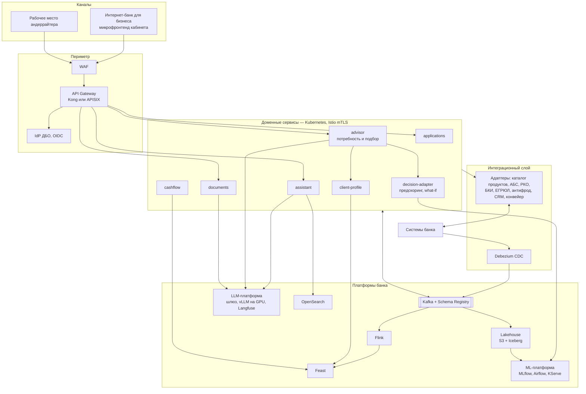

| Компонент | Роль | Почему |
| --- | --- | --- |
| advisor | Понимание потребности и подбор поверх каталога банка | Та же логика, что в прототипе; каталог и правила — из продуктовой системы |
| decision-adapter | Предскоринг и решение через API конвейера; модель кабинета — challenger и what-if после валидации риском | Кредитное решение остаётся в зоне ответственности риска |
| Kafka + Schema Registry | Шина событий | Те же топики и схемы, что в прототипе |
| Debezium CDC, Flink, Feast | Транзакции из АБС и РКО в реальном времени → агрегаты → единые признаки online и offline | Профиль и прогноз обновляются за минуты; нет расхождения train/serve |
| ML-платформа | Реестр, переобучение, сервинг с canary | Управляемый жизненный цикл, валидация моделей |
| LLM-платформа | On-prem LLM, квоты, маскирование ПДн, трассировка и оценка | Данные не покидают банк |
| OpenSearch | Гибридный поиск по базе знаний, логи | Масштабируемый поиск вместо pgvector |
| Lakehouse | История транзакций, рекомендаций и решений | Обучение весов ранжирования и моделей на реальной истории; когорты для контроля риска |
| API Gateway, WAF, IdP ДБО, Istio, Vault | Периметр, аутентификация, mTLS, секреты | Требования ИБ банка |

## 18. Путь миграции

Миграция — замена реализаций портов и инфраструктуры; движок подбора, контракты API, топики и схемы событий не меняются.

| Этап | Что меняется | Что остаётся |
| --- | --- | --- |
| 1. Данные и каталог банка | bank-sim → адаптеры АБС и РКО; синтетический реестр → сервис ЕГРЮЛ/ЕГРИП банка; конфигурация каталога → CatalogPort к продуктовой системе; вход по ИНН → IdP ДБО; согласие на БКИ и шлюз БКИ | Движок подбора, профиль, прогноз, заявки |
| 2. Контур и безопасность | Локальная LLM прототипа → on-prem за шлюзом банка; Compose → Kubernetes, Helm, GitOps; Vault, Istio, WAF, API Gateway | Извлечение потребности, агент, защита, наборы оценки |
| 3. Решение и модели | DecisionPort и расчёт шанса в подборе → предскоринг конвейера; модель кабинета — challenger после валидации риском; веса ранжирования переобучаются на реальных выборах клиентов | Снимки подбора и решения, reason codes, what-if |
| 4. Поток и масштаб | Redpanda → Kafka банка; Debezium CDC и Flink; Feast; pgvector → OpenSearch | Топики и схемы, FeatureBuilder как спецификация признаков |

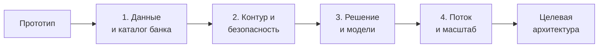

## 19. План на 7 дней

Ядро подбора собирается первым и к концу 3-го дня работает сквозно: ИНН + ситуация → рекомендация, с посчитанными метриками. Дни 4–6 — заявка до решения и расширения; 7-й — стабилизация и репетиции. Каждый вечер — сборка стенда и прогон сквозных тестов.

| День | Frontend | Backend | DS/ML | Product/UX/BA | Контрольная точка |
| --- | --- | --- | --- | --- | --- |
| 1 | Каркас web (FastAPI + Jinja2 + HTMX), макеты подбора: поле «Опишите задачу», карточка потребности, карточка рекомендации, сравнение | Compose, Redpanda, PostgreSQL, outbox, OpenAPI и схемы событий, каркас bank-sim | Генераторы компаний и транзакций, FeatureBuilder v1 | Каталог из 6 продуктов, правила допуска, матрица «цель × продукт», первые 50 ситуаций; JTBD и user story map по бизнес-требованиям кейса (DEL-08) | Контракты v1 заморожены |
| 2 | Вход по ИНН, профиль, карточка потребности, вопросы-кнопки | Цепочка реестра, вход, генерация bank-sim, модуль advisor: потребность, вызов движка | PD-модель + калибровка; NeedExtractor и нормализация; Eligibility и OfferCalculator; выбор open-weights модели, замер памяти и задержек на 16 ГБ | Ещё 100 ситуаций, разметка двумя экспертами | Профиль + понятая потребность |
| 3 | Карточка рекомендации, сравнение, «почему не X», «Оформить» | QuestionPlanner, снимок подбора, SSE чата, черновик из подбора | Ranker, Diversifier, probe, why\_not; прогон оценки подбора | Тексты объяснений и причин допуска | **Ядро подбора: ИНН + текст → рекомендация; top-1 посчитан** |
| 4 | Заявка, чек-лист, загрузка, статусы, экран решения, симулятор what-if | Заявки, машина статусов, события скоринга, загрузка документов, запрос уточнения и изменение условий (UW-05, UW-06) | ScoringEngine, SHAP → reason codes, WhatIfEngine, согласованность подбора и решения | Golden set ассистента и атаки | Подбор → заявка → решение → what-if |
| 5 | «Финансовый пульс», карточка разрыва, правка полей документа, панель андеррайтера | doc-service для PDF, андеррайтинг, расхождения, пересчёт подбора по `profile.updated` | Прогноз и разрывы, потребность из разрыва; извлечение шапки выписки, категоризация | База знаний, демо-компании под сценарии, материалы ленты | Сценарии 1–5 проходят |
| 6 | Полировка, мобильная вёрстка, состояния ошибок | Наблюдаемость, дашборд подбора, ворота CI, нагрузочный прогон | Подбор весов по разметке, сканы, оценка ассистента и LLM-судья, карточки моделей | Презентация, метрики, экономика; README, THIRD_PARTY_NOTICES, коллекция запросов, ER-диаграмма, тест-кейсы (DEL-04–DEL-07) | Заморозка функций |
| 7 | Исправления | Режим без сети, запасное видео; тег версии и доступ для `alfa-hack-2026` (DEL-01) | Финальные метрики на слайд | Три репетиции питча | Готово к защите |

Must (ТЗ, раздел 3.1) готов к концу 4-го дня; если к концу 3-го дня ядро подбора не собрано, вся команда переключается на него. Should делаются по порядку S1 → S13 и при нехватке времени урезаются в обратном порядке: лента (S13) → подписание (S12) → справедливость (S11) → дашборды (S10) → трассировка LLM (S9) → подбор весов (S8) → база знаний (S7) → отчётность (S6) → сканы (S5) → расхождения для андеррайтера (S4) → прогноз (S3) → распознавание выписки (S2) → «что сделать» (S1). Метрики при отказе от дашбордов остаются в отчёте CI.

## 20. Риски, демо-сценарии, журнал ADR

### 20.1. Риски

| Риск | Мера |
| --- | --- |
| Подбор выглядит как «простые правила» | Показываем свободный текст, умные уточнения, пересчёт от выписки и прогноза, вклад факторов, метрики против экспертов, подбор весов по разметке |
| Эталон подбора субъективен | Два эксперта, разбор расхождений, допустимые альтернативы в эталоне |
| LLM плохо извлекает потребность | JSON-схема, нормализация парсером, примеры, уверенность и карточка для правки; форма без LLM |
| Подбор обещает, а решение отказывает | Одна модель и одна конфигурация; метрика согласованности в CI |
| Событийная схема усложняет отладку | Redpanda Console, `correlation_id`, сквозные тесты каждый вечер |
| Лицензии Redpanda (BSL) и Arize Phoenix (Elastic License 2.0) не относятся к OSI | Бесплатны для самостоятельного запуска и не требуют подписки (NFR-19); лицензии записываются в THIRD_PARTY_NOTICES; замена при возражениях жюри — Apache Kafka и Tempo без Phoenix |
| Распознавание сканов нестабильно | Must — PDF с текстом; сканы — Should |
| LLM недоступна на демо | Запасной провайдер, подбор через форму |
| Демо-компания меняет итог после переобучения | Тест ожидаемых рекомендаций и решений в CI |
| Жюри ждёт реальных данных реестра | Кейс требует синтетику; карточки помечены «Реестр — демо», формат как у ЕГРЮЛ/ЕГРИП, реальный реестр подключается через RegistryPort |
| Локальная LLM медленная или не помещается в 16 ГБ | Малая квантизованная модель, замеры в день 2, форма без LLM |
| Закрытая модель или платный сервис в проверяемой версии | Проверка списка моделей и лицензий в CI, THIRD_PARTY_NOTICES |

### 20.2. Демо-сценарии

| Сценарий (ТЗ, раздел 11) | Что на сцене | Доказывает |
| --- | --- | --- |
| **1. Ядро:** ИНН → «нужно 2 млн на закупку к сезону, верну к марту» → 1 уточнение → рекомендация и альтернативы → «почему не овердрафт?» → оформить → одобрено | Реестр, NeedExtractor, QuestionPlanner, движок подбора, объяснение, скоринг | ИИ понимает ситуацию и подбирает кредит, решение совпадает с подбором |
| 2. Проактивный разрыв → готовая рекомендация | Прогноз, потребность из разрыва, подбор | Подбор до того, как клиент спросил |
| 3. Выписка другого банка → подбор пересчитан | doc-service, `profile.updated`, подбор | Документы делают подбор точнее |
| 4. Нет подходящих вариантов → what-if → андеррайтер | WhatIfEngine, SHAP, панель андеррайтера | Путь к «да» и человек в контуре |
| 5. ИНН из синтетического реестра и отсутствующий ИНН, ликвидированная компания, нецелевой запрос, атаки | Реестр, защита ассистента | Обработка статусов реестра и честный ИИ |
| 6. Доп. проверка → запрос уточнения → ответ клиента → одобрение с изменённым сроком (DEMO-6) | Панель андеррайтера, статусы, снимок решения | Человек в контуре, клиент понимает, что от него нужно |
| 7. Лента двух компаний, пересчёт после потребности и подачи (DEMO-7, S13) | feed, SSE | Персонализация |
| Финал: дашборды | Дашборд подбора, MLflow, Phoenix | Метрики: top-1 к экспертам, согласованность, время до рекомендации |

### 20.3. Журнал ADR

| ADR | Решение | Отвергнутые альтернативы | Почему |
| --- | --- | --- | --- |
| 01 | **Подбор — гибрид: LLM понимает текст, движок на правилах и PD-модели выбирает, ранжирование прозрачное** | LLM выбирает продукт сама; чистые правила без понимания текста | Точность, воспроизводимость, объяснимость; LLM не придумывает условия |
| 02 | **Одна PD-модель, один FeatureBuilder и одна конфигурация для подбора, решения и what-if** | Отдельная эвристика для подбора | Рекомендация не противоречит решению |
| 03 | **Уточнения по чувствительности подбора** | Фиксированная анкета | Клиент отвечает только на то, что меняет результат |
| 04 | Расширения встроены в конвейер подбора через профиль и потребность | Отдельные витрины | Каждая фича усиливает основную цель |
| 05 | Два уровня архитектуры, порты и адаптеры | Только прототип; только целевая | Реализуемо за неделю и с понятным путём в банк |
| 06 | Четыре сервиса: core-api, ml-service, doc-service, bank-sim | Монолит; микросервис на сущность | Разные профили нагрузки при команде из четырёх |
| 07 | События через Kafka API, outbox, идемпотентность, DLQ | HTTP между всеми сервисами | Асинхронность тяжёлого; те же топики в банке |
| 08 | PD: бустинг с монотонными ограничениями + скоркарта, калибровка | Только скоркарта; нейросеть | Качество, объяснимость, привычный банку формат |
| 09 | Прогноз: регулярные платежи + квантильная модель + Монте-Карло | Одна линия прогноза | Вероятность, размер и причины разрыва |
| 10 | What-if полным перебором | Приближённый поиск контрфактов | Точный результат за ≤ 1 с |
| 11 | Document AI: текстовый слой или OCR + LLM по схеме + арифметические проверки | Только LLM по изображению | Проверяемость каждого числа |
| 12 | OpenTelemetry + трассировка LLM | Только логи | Путь подбора и заявки виден целиком |
| 13 | Локальная LLM с открытыми весами — единственный провайдер проверяемой версии; реестр синтетический, облако и DaData не используются | GigaChat и YandexGPT по API как основной провайдер | Требования кейса: открытые веса, без платных ресурсов, автономность |
| 14 | Запрос уточнения — отдельный статус заявки, изменение условий андеррайтером в границах продукта | Только «одобрить» или «отказать» | Кейс допускает исход «запросить информацию» и «иные условия» |
| 15 | Python 3.12 — единственный язык серверной части, ML, генераторов, воркеров и тестов; зависимости фиксирует `uv` (`uv.lock`) | Java/Kotlin для core-api, Node.js для интерфейса | Решение владельца проекта: кейс на стеке Python. Одна экосистема: FeatureBuilder, модели и сервисы используют один код признаков (РШ-2) |
| 16 | FastAPI + Pydantic v2 для HTTP-сервисов; контракт-first: OpenAPI → модели Pydantic, соответствие реализации контракту проверяет schemathesis в CI | Flask, Django REST | Async, SSE, валидация на границе, OpenAPI из коробки; контракт остаётся источником правды |
| 17 | web — серверный рендеринг: FastAPI + Jinja2 + HTMX (SSE-расширение), статика и Chart.js вендорятся | React/Vue SPA с Node-сборкой | Стек Python; нет Node-сборки и CDN, поэтому работает офлайн (NFR-19); вёрстка от 360 px (NFR-16) |
| 18 | PostgreSQL 16 + SQLAlchemy 2.0 (async) + Alembic; брокер — `confluent-kafka` | Django ORM, Tortoise, aiokafka | Зрелый стек, RLS, транзакционный outbox, подтверждённая работа с Schema Registry |
| 19 | ML: LightGBM (монотонные ограничения), scikit-learn (изотоническая калибровка, логрегрессия), SHAP (TreeSHAP), optbinning (WoE), MLflow | CatBoost, нейросети | Открытые лицензии, монотонные ограничения, быстрый TreeSHAP на CPU |
| 20 | Агент ассистента без LangChain: собственный оркестратор поверх `openai`-SDK, направленного на локальную Ollama; структурированный вывод по JSON-схеме и проверка Pydantic | LangChain, LlamaIndex | Полный контроль над защитами AI-08–AI-11 и белым списком инструментов, меньше зависимостей, предсказуемое поведение |
| 21 | Монорепозиторий `uv`: один workspace и один корневой `uv.lock` на все сервисы, `web` и `libs/*`; образы собираются `uv sync --frozen --package <service>`; расхождение `pyproject.toml` и `uv.lock` ловит `uv lock --check` в pre-commit и `make check` (CI не используется — решение владельца, конвейер — E16). Сервисы не зависят друг от друга, только от `libs/*` (проверяет `tests/test_workspace.py`) | Lock-файл на каждый сервис; Poetry/pip-tools | Единые версии общих библиотек (РШ-2), эквивалент «lock каждого сервиса» по NFR-20 за счёт `--package` |
| 22 | Конфиги — YAML в `config/`, читает `cabinet_common.config.load_config`: схема Pydantic на файл (`extra=forbid`, поле `version` типа `Version` контракта), хэш SHA-256 байтов файла; ошибка чтения или схемы — `ConfigError`, сервис не стартует | JSON/TOML, конфиги в БД, схема без запрета лишних полей | YAML удобен Product для текстов; запрет лишних полей ловит опечатки; версия и хэш идут в снимки (подотчётность) |
| 23 | Объектное хранилище MinIO из образа `bitnamilegacy/minio` с закреплённым тегом (2025.4.22) | `minio/minio` (снят с Docker Hub), `quay.io/minio/minio` (требует авторизации), Garage, SeaweedFS | Единственный доступный без авторизации образ настоящего MinIO с S3 API и консолью; `boto3` и MLflow работают без изменений. Образ больше не обновляется — для прототипа без сети приемлемо; в банке — управляемое S3-хранилище (порт хранилища) |
| 24 | Миграции: по одной Alembic-среде на схему (`core`, `kb`, `bank`, `ml`, `docs`) в `services/<сервис>/migrations/<схема>/`, версия в `<схема>.alembic_version`; bootstrap от суперпользователя создаёт расширения `vector`, `pgcrypto`, пять ролей `cabinet_<схема>` (пароль из `DB_<СХЕМА>_PASSWORD`) и схемы; миграции идут под ролью-владельцем схемы (async psycopg 3). RLS по `company_id` — только в `core` (`SET LOCAL app.company_id`, `FORCE`); `recommendation` и `decision` защищены триггерами (у `decision` допускается дописывать итог, андеррайтера и уточнения) | Одна общая среда на все схемы; миграции от суперпользователя; RLS и в `ml`/`docs`/`bank`; права вместо триггеров | Изоляция сервисов проверяется правами роли, а не соглашением; межсхемных FK нет (тест); права вместо триггеров не защищают от владельца схемы, а он и есть роль сервиса |

## 21. Технологический стек (Python)

Язык серверной части, ML, генераторов данных, воркеров, тестов и веб-интерфейса — Python 3.12 (NFR-23, ADR 15). Технологический выбор в рамках стека принимает исполнитель; он фиксируется здесь и в журнале ADR (раздел 20.3), изменение — новым ADR. Лицензии сверяются при составлении THIRD_PARTY_NOTICES (E17-02) и проверяются в CI.

| Область | Выбор | Зачем |
| --- | --- | --- |
| Язык, пакеты | Python 3.12, `uv` (workspace, `uv.lock`), `pyproject.toml` на каждый сервис | Воспроизводимость (NFR-20) |
| HTTP-сервисы | FastAPI, Uvicorn, Pydantic v2, `pydantic-settings`, `sse-starlette`, `httpx` | OpenAPI, async, SSE, валидация на границе |
| Конфиги | PyYAML (`safe_load`), Pydantic v2 | Схема на каждый файл `config/*.yaml`, версия и хэш содержимого для снимков (ADR 22) |
| Контракт | Источник — OpenAPI и JSON Schema; модели Pydantic генерирует `datamodel-code-generator` в пакет `libs/contracts`; соответствие проверяет `schemathesis` | Контракт — закон; ответ сервиса не расходится с контрактом |
| База данных | PostgreSQL 16 + pgvector, SQLAlchemy 2.0 (async, psycopg 3), Alembic; Row-Level Security по `company_id` | NFR-13, схема на сервис (раздел 11.1) |
| События | `confluent-kafka` + Schema Registry Redpanda, `jsonschema`; outbox-релей — отдельный режим запуска сервиса | Раздел 9 |
| Кэш и лимиты | Redis 7, `redis-py` (asyncio) | Кэш реестра и подбора, идемпотентность, SSE pub/sub |
| Файлы | MinIO через `boto3`; ClamAV по протоколу clamd; `python-magic` (тип по содержимому); `pikepdf` (очистка PDF); `openpyxl` (проверка макросов XLSX) | DOC-01, NFR-14 |
| Документы | `pdfplumber` (текст, таблицы), Tesseract через `pytesseract` (S5), `reportlab` (генерация синтетических PDF) | Раздел 4 |
| ML | LightGBM, scikit-learn, SHAP, `optbinning`, pandas, NumPy, SciPy; MLflow (реестр и эксперименты) | Разделы 5–7, 12 |
| Данные | Генераторы на NumPy и `Faker` (ru_RU) с фиксированным seed; общая библиотека `libs/featurebuilder` — единственная сборка признаков | РШ-2, REG-07, NFR-15 |
| LLM | Ollama; основная модель — Qwen2.5-7B-Instruct, квантизация Q4_K_M, открытые веса (Apache 2.0); решение подтверждается замером памяти и качества (E02-07); клиент — `openai` SDK на локальный адрес | NFR-18, NFR-22 |
| Эмбеддинги | `bge-m3` (MIT) через Ollama | База знаний (S7), без `torch` в образах сервисов |
| Интерфейс | FastAPI + Jinja2 + HTMX (расширение SSE) + Alpine.js; Chart.js для «Финансового пульса»; собственный CSS; всё вендорится в репозиторий | NFR-16, NFR-19 |
| Безопасность | `PyJWT`, `argon2-cffi`, собственный CSRF-слой (токен из `GET /auth/me`), Nginx rate limit + токен-бакет в Redis | Раздел 14 |
| Наблюдаемость | OpenTelemetry Python SDK и автоинструментация FastAPI, `structlog`, `prometheus-client`; Phoenix — S9 | Раздел 15 |
| Качество кода | `ruff` (линтер и формат), `mypy`, `pre-commit` | CI (раздел 16) |
| Тесты | `pytest`, `pytest-asyncio`, `hypothesis` (формулы REC и SC), `schemathesis`, Playwright для Python (UI), Compose-стенд для e2e | NFR-02, раздел 4.6 |
| Образы | `python:3.12-slim`, multi-stage сборка через `uv`, запуск не от root, один образ на сервис с режимами `api` / `consumer` / `relay` | NFR-01, NFR-22 |

### 21.1. Структура репозитория

Дополнение к дереву раздела 16: корневой `pyproject.toml` с workspace `uv`; пакеты `libs/common` (конфигурация, логирование, JWT, outbox, идемпотентность), `libs/contracts` (модели из контракта), `libs/featurebuilder` (признаки). Сервисы в `services/*` зависят от `libs/*` и не зависят друг от друга: общение только по контракту и событиям.

### 21.2. Правила стека

1. Новый язык или рантайм в проверяемой версии не добавляется (NFR-23); JavaScript допустим только как вендорные статические библиотеки интерфейса.
2. Зависимость добавляется только с открытой лицензией и записью в `uv.lock` и THIRD_PARTY_NOTICES.
3. Расчёты подбора, решения и what-if вызывают одни и те же функции из `libs/featurebuilder` и ml-service (РШ-2); дублировать формулы в других сервисах нельзя.
4. Python-код проходит `ruff` и `mypy` без ошибок; формулы REC и SC покрыты `hypothesis`-тестами на границах.

