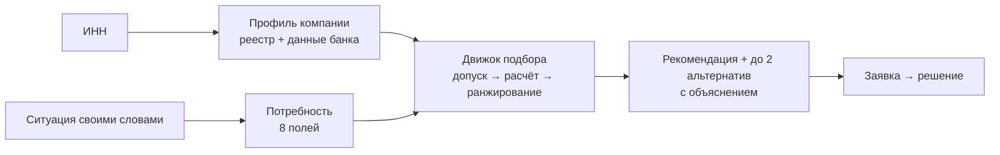

# ТЗ: Умный кредитный кабинет предпринимателя (ММБ)

Версия 4.1 · хакатон, 7 дней · команда: Frontend, Backend, DS/ML, Product/UX/BA

Язык разработки и фреймворки выбирает команда. В ТЗ указаны функции, данные, формулы, модели, метрики и инфраструктурные компоненты. Все числовые параметры (пороги, ставки, веса) — стартовые значения конфигурации: их можно менять без изменения кода, но любое изменение фиксируется версией.

**Что изменилось в 4.1.** Документ проверен по критериям полноты, однозначности, проверяемости, непротиворечивости, атомарности, корректности, необходимости, трассируемости и приоритизации. Добавлены формулы, пороги, справочники, значения по умолчанию, колонка «Проверка» у каждого требования, порядок приоритетов Should и матрица трассируемости (раздел 13). Устранены противоречия с архитектурой.

## 0. Цель кейса и решение

**Цель кейса.** Личный кабинет для малого и микробизнеса с ИИ-ассистентом, который:

| ID | Цель кейса |
| --- | --- |
| К-1 | Понимает потребность клиента |
| К-2 | Помогает выбрать подходящий кредитный продукт |
| К-3 | Проводит клиента от заявки до решения |

**Ядро решения — ИИ-подбор кредита.** Система сама собирает данные о компании (реальный реестр ЕГРЮЛ/ЕГРИП + демо-данные банка), понимает ситуацию, которую клиент описал своими словами, и выдаёт рекомендацию: продукт, сумму, срок, платёж, шанс одобрения, причины выбора и альтернативы. Из рекомендации заявка оформляется одной кнопкой.

**Четыре расширения усиливают подбор:**

| Расширение | Что даёт подбору | Раздел | Приоритет |
| --- | --- | --- | --- |
| Распознавание документов | Обороты в других банках → выше доступная сумма и точнее шанс одобрения | 5.1 | S2 |
| Прогноз кассовых разрывов | Потребность формируется до того, как клиент написал | 5.2 | S3 |
| «Что сделать, чтобы одобрили» | Если подходящий вариант недоступен — минимальные изменения, которые дают «да» | 5.3 | S1 |
| Объяснимый скоринг и честный ассистент | Решение считается той же моделью, что и подбор; ассистент объясняет, но не обещает | 5.4 | M |

## 1. Проблема, гипотеза, ключевые решения

**Проблема.** Предприниматель не знает, какой кредитный продукт подходит под его задачу: выбирает по ставке без учёта срока, платежа и требований, повторно вводит данные, которые банк уже знает, подаёт заявку на недоступный продукт и получает отказ без объяснения.

**Гипотеза.** Если система по данным компании и описанию ситуации выбирает тот же продукт, что и эксперт, в ≥ 85% случаев (Q-02), то на пилоте в банке: время от входа до заявки сокращается до нескольких минут; доля отказов среди поданных заявок снижается; клиент понимает, почему ему подходит выбранный продукт. В прототипе проверяются метрики раздела 4.6; эффекты на клиентов проверяются на пилоте.

**Ключевые решения**

| ID | Решение | Следствие в требованиях |
| --- | --- | --- |
| РШ-1 | Подбор — гибрид: LLM извлекает потребность из текста; продукт, сумму, ставку и шанс одобрения считает детерминированный движок на правилах и PD-модели | NEED-02, REC-01–REC-07 |
| РШ-2 | Подбор, решение по заявке и «что сделать» используют одну PD-модель, одни признаки, одни пороги и одни формулы лимита и ставки | REC-02, SC-04, SC-05, Q-06 |
| РШ-3 | Подбор работает без LLM: структурированная форма потребности вызывает тот же движок | NEED-01, NFR-09 |
| РШ-4 | Любое число в ответе ассистента берётся из результатов инструментов: модель пишет плейсхолдеры, система подставляет значения и проверяет текст | AI-08 |
| РШ-5 | Действия, меняющие данные (создать заявку, перенести значение, подать, применить вариант), выполняются только по нажатию кнопки клиентом | REC-16, AI-04, AI-11, WI-07 |
| РШ-6 | Реестровые данные — реальные открытые данные ЕГРЮЛ/ЕГРИП; банковские данные генерируются детерминированно по ИНН; документы для демо и оценки — синтетические | REG-05–REG-07, раздел 7 |
| РШ-7 | Объяснения строятся только из сохранённых причин допуска, вкладов факторов ранжирования, reason codes и SHAP; ассистент пересказывает, не придумывает | REC-12, REC-14, SC-06 |
| РШ-8 | Тяжёлые операции (распознавание, скоринг заявки, прогноз) выполняются асинхронно через брокер событий | NFR-04, архитектура раздел 9 |
| РШ-9 | Демо не зависит от DaData: реестр берётся из кэша и сохранённых ответов. При недоступности LLM подбор идёт через форму | NFR-08, NFR-09 |

## 2. Глоссарий

| Термин | Определение |
| --- | --- |
| Профиль компании | Набор показателей компании из раздела 4.1 (PRF-01–PRF-10), рассчитанный из реестра, банковских данных и распознанных документов |
| Потребность | Восемь полей из раздела 4.2, описывающих задачу клиента |
| Поступления | Зачисления категории «Поступления от покупателей» (DOC-05). Не включают переводы между своими счетами и получение кредитов |
| Свободный денежный поток (СДП) | Среднемесячные за последние 6 месяцев поступления минус все списания, кроме платежей по кредитам и переводов между своими счетами |
| PD | Вероятность дефолта в течение 12 месяцев по PD-модели (SC-02) |
| Грейд | Класс риска по PD: A, B, C, D (раздел 4.3, таблица грейдов) |
| Допуск | Проверка соответствия компании и потребности жёстким условиям продукта (REC-01) |
| Вариант | Продукт с рассчитанными суммой, сроком, ставкой, платежом, переплатой, PD и шансом одобрения (REC-02) |
| Шанс одобрения | Категория «высокий», «средний» или «низкий» по правилу REC-03 |
| Снимок подбора | Неизменяемая запись результата подбора со всеми входами, промежуточными расчётами и версиями (REC-08) |
| Снимок решения | Неизменяемая запись решения по заявке (SC-07) |
| Reason code | Код причины из справочника раздела 5.4 с утверждённым текстом для клиента |
| SHAP | Вклад признака в PD конкретной заявки |
| Демо-данные | Синтетические банковские данные; в интерфейсе помечаются «данные банка — демо» |

## 3. Пользователи и пути

| Персона | Кто это | Задача | Барьер сегодня |
| --- | --- | --- | --- |
| ИП, микробизнес | Розница, услуги, онлайн-торговля; финансы ведёт сам | Закрыть кассовый разрыв, закупить товар | Не понимает разницу между продуктами; нет времени |
| Малое ООО | Опт, производство, B2B; есть бухгалтер | Оборотные средства под сезон, оборудование | Обороты в нескольких банках, непонятный отказ |
| Андеррайтер банка | Рассматривает заявки в зоне доп. проверки | Обоснованно принять решение | Неполные заявки, ручная сверка |

**Пути**

1. **Основной (M):** вход по ИНН → профиль собран автоматически → клиент описывает ситуацию → уточняющие вопросы (NEED-05) → рекомендация и альтернативы → заявка → решение.
2. **После низкого шанса или отказа (S1):** «Что сделать, чтобы одобрили» → изменённые условия → новая версия заявки → решение.
3. **С документами (S2):** загрузка выписки другого банка → профиль и подбор пересчитаны.
4. **Проактивный (S3):** прогноз находит разрыв → карточка с готовой рекомендацией → заявка.
5. **Андеррайтер (M):** очередь → карточка заявки → решение с комментарием.

### 3.1. Объём и приоритеты

| Приоритет | Что входит | Правило |
| --- | --- | --- |
| M (Must) | Все требования с пометкой M в колонке «Пр.»: раздел 4, DOC-01 и DOC-02 из раздела 5.1, раздел 5.4, раздел 6 | Без них не проходят DEMO-1 и DEMO-5; не урезается |
| S1 | «Что сделать, чтобы одобрили» (WI-01–WI-07) | Делается после готовности всех M |
| S2 | Распознавание выписки PDF с текстовым слоем (DOC-03–DOC-06, DOC-08, WI-08), статус «Документы распознаются» (APP-04) | После S1 |
| S3 | Прогноз и карточка разрыва (CF-01–CF-06, AI-03) | После S2 |
| S4 | Расхождения в панели андеррайтера (UW-03) | После S3 |
| S5 | Распознавание сканов (DOC-07) | После S4 |
| S6 | Распознавание отчётности (DOC-09) | После S5 |
| S7 | База знаний с поиском (AI-12) | После S6 |
| S8 | Подбор весов ранжирования по разметке (REC-11, Q-04) | После S7 |
| S9 | Трассировка LLM-вызовов (NFR-10) | После S8 |
| S10 | Дашборды (NFR-11) | После S9 |
| S11 | Отчёт о справедливости модели (ML-09) | После S10 |
| C (Could) | Объяснение прогноза по платежам в чате (CF-07); экспорт рекомендации и решения в PDF | Только при запасе времени |
| W (Won't) | Раздел 14 | Не делается |

При нехватке времени Should урезаются в обратном порядке: сначала S11, затем S10, S9 и далее до S1. Must не урезается.

## 4. Основная цель: ИИ-подбор кредита

### 4.1. Данные о компании (К-2)

| ID | Требование | Пр. | Проверка |
| --- | --- | --- | --- |
| REG-01 | Вход по ИНН: 10 цифр для юрлица или 12 для ИП, проверка контрольной суммы ИНН по алгоритму ФНС до запроса к реестру | M | Тест: валидный, невалидный по контрольной сумме, 11 цифр, буквы |
| REG-02 | Перед входом показывается предпросмотр компании: наименование, ОПФ, статус, адрес | M | Тест на 3 реальных ИНН и 1 ИНН из сохранённых ответов |
| REG-03 | Ошибки входа: «ИНН указан неверно» (контрольная сумма), «Компания не найдена в реестре» (нет в реестре). Ликвидированная компания входит, видит статус, подбор возвращает STOP_REGISTRY | M | Тест: 3 случая, тексты совпадают |
| REG-04 | Вход под демо-компанией из списка (раздел 7, таблица демо-компаний) | M | В списке все компании DC-1–DC-5 |
| REG-05 | Реквизиты из ЕГРЮЛ/ЕГРИП через API DaData «Организация по ИНН» (бесплатный тариф): наименование, ИНН, КПП, ОГРН, ОПФ, руководитель или ФИО ИП, адрес, основной ОКВЭД, статус, дата регистрации | M | Сверка с ответом DaData для 3 ИНН |
| REG-06 | Источник реестра выбирается по порядку: кэш младше 24 ч → DaData (таймаут 3 с) → сохранённый ответ из репозитория → синтетика с пометкой «Реестр недоступен, демо-данные» | M | Тест каждого шага с отключением предыдущего |
| REG-07 | Банковские данные компании (счёт, дневные операции за 12 месяцев, кредитная история, флаг антифрода) генерируются при первом входе; зерно генератора — ИНН; отраслевая группа и возраст берутся из реестра | M | Два входа под одним ИНН дают идентичные данные |
| REG-08 | У каждого поля профиля в интерфейсе виден источник («ЕГРЮЛ», «данные банка — демо», «из документа», «прогноз») и дата получения | M | Проверка экрана профиля: у 100% полей есть источник и дата |

**Профиль компании для подбора** (PRF-01–PRF-10, M). Показатели пересчитываются при появлении новых данных (документ — S2, прогноз — S3).

| ID | Показатель | Формула | Источник |
| --- | --- | --- | --- |
| PRF-01 | ОПФ | ИП или ООО | Реестр |
| PRF-02 | Отраслевая группа | Основной ОКВЭД → группа по таблице «ОКВЭД → отраслевая группа» (раздел 6) | Реестр |
| PRF-03 | Возраст бизнеса, мес. | Полные месяцы от даты регистрации до текущей даты | Реестр |
| PRF-04 | Статус | Значение статуса из реестра: действующая, ликвидируется, ликвидирована, банкротство, реорганизация | Реестр |
| PRF-05 | Средние поступления за 3, 6, 12 мес. | Сумма поступлений за период / число месяцев; отдельно по банку, по другим банкам (S2) и итого | Транзакции, выписки |
| PRF-06 | Сезонность | (максимум − минимум месячных поступлений за 12 мес.) / средние поступления за 12 мес. | Транзакции |
| PRF-07 | Волатильность | Стандартное отклонение месячных поступлений за 12 мес. / средние поступления за 12 мес. | Транзакции |
| PRF-08 | СДП в месяц | По определению из глоссария; итого по банку и другим банкам | Транзакции, выписки |
| PRF-09 | Текущие платежи по кредитам в месяц | Сумма ежемесячных платежей по действующим кредитам | Кредитная история |
| PRF-10 | Максимальная просрочка за 12 мес., дней; месяцев с поступлениями за последние 6 мес. | По данным кредитной истории; число месяцев с хотя бы одним поступлением | Кредитная история, транзакции |

Проверка PRF: модульные тесты формул на 3 синтетических компаниях с заранее посчитанными значениями (допуск 1 ₽).

### 4.2. Потребность (К-1)

| ID | Требование | Пр. | Проверка |
| --- | --- | --- | --- |
| NEED-01 | Клиент описывает задачу свободным текстом в поле «Опишите задачу» на главной или в чате; рядом есть ссылка на структурированную форму с теми же 8 полями | M | Оба входа создают потребность одного формата |
| NEED-02 | LLM извлекает из текста фрагменты для 8 полей по JSON-схеме; суммы, сроки и даты из фрагментов приводит к значениям детерминированный парсер. Поддерживаемые формы суммы: число с единицей «руб», «тыс», «т.р.», «к», «млн», «лям», «ляма», «лямов»; числительные от «одного» до «двадцати» и «полтора», «пол». Формы срока: «N дней / недель / месяцев / лет», «полгода», «год», «до <месяц>», «к <месяц>», «до <дата>» | M | Q-01 на эталонном наборе |
| NEED-03 | Уверенность поля: 1 — значение найдено в тексте и разобрано парсером; 0,5 — выведено LLM без явного фрагмента; 0 — не найдено. Поля с уверенностью 0,5 выделяются в карточке потребности для подтверждения | M | Тест на 10 текстах с ожидаемой уверенностью |
| NEED-04 | Карточка потребности показывает 8 полей; клиент может изменить любое поле до и после подбора; изменение запускает пересчёт (REC-10) | M | UI-тест |
| NEED-05 | Уточняющие вопросы: поле «Цель» спрашивается всегда, если его уверенность 0. Поле со значением по умолчанию спрашивается, только если при пробных значениях (таблица ниже) меняется лучший продукт. Первым спрашивается поле, при котором меняется лучший продукт для большего числа пробных значений; при равенстве — по порядку строк таблицы полей. Не больше 5 вопросов; ответы — кнопками | M | Q-05 на симуляторе клиента |
| NEED-06 | Если сумма не указана: при найденном разрыве (S3) нужная сумма = дефицит по CF-05. Иначе подбор выполняется с нужной суммой, равной максимуму каждого продукта, F2 = 1, а предложенная сумма = доступная сумма лучшего варианта. В карточке потребности рядом с суммой — пояснение источника цифры | M | Тест на 2 случаях |
| NEED-07 | Нецелевой запрос — запрос о вкладе, эквайринге, открытии счёта, потребительском кредите, ипотеке, кредитной карте физлица, лизинге, страховании или любой запрос, не связанный с финансированием бизнеса. Ответ — шаблон «Я подбираю кредиты для бизнеса. С этим вопросом поможет сотрудник банка» и кнопка «Связаться с сотрудником» | M | Q-07 на 20 нецелевых текстах |
| NEED-08 | Срок, указанный датой, переводится в месяцы: число дней от текущей даты до указанной / 30, с округлением вверх. «К <месяц>» и «до <месяц>» означают 1-е число этого месяца; если месяц уже прошёл в текущем году — следующего года | M | Тест: «к марту» при дате 14.10.2026 → 01.03.2027 → 5 мес. |

**Поля потребности**

| № | Поле | Значения | По умолчанию, если не указано | Пробные значения для NEED-05 |
| --- | --- | --- | --- | --- |
| 1 | Цель | Кассовый разрыв; закупка товара или сырья; сезонная подготовка; оборудование и транспорт; ремонт и расширение; исполнение контракта; другая бизнес-цель | Нет — обязательный вопрос | — |
| 2 | Сумма, ₽ | Число или «не знаю» | По NEED-06 | — |
| 3 | Срок, мес. | Целое число месяцев | 12 | 6, 12, 24, 36 |
| 4 | Обеспечение | Набор из: нет, оборудование, транспорт, недвижимость, поручитель; для оборудования, транспорта и недвижимости — стоимость, ₽ | Нет | Нет; недвижимость стоимостью 2 × суммы |
| 5 | Срочность | Сегодня–завтра; в течение недели; не срочно | Не срочно | Сегодня–завтра; не срочно |
| 6 | Приоритет | Минимальный платёж; минимальная переплата; скорость; без залога; не указан | Не указан | Не указан; минимальный платёж; минимальная переплата; без залога |
| 7 | Регулярность | Разовая; повторяющаяся | Разовая | Разовая; повторяющаяся |
| 8 | Комфортный платёж, ₽/мес. | Число или «не знаю» | Не учитывается | — |

Значение по умолчанию помечается в карточке как «допущение».

**Правило выбора цели** (для LLM, разметчиков эталона и формы)

| Цель | Когда выбирается |
| --- | --- |
| Кассовый разрыв | Не хватает денег на текущие платежи: налоги, зарплату, аренду, поставщикам |
| Закупка товара или сырья | Названа покупка товара, сырья или материалов — в том числе к сезону |
| Сезонная подготовка | Подготовка к сезону без названной закупки или с несколькими направлениями расходов (персонал, реклама, запасы) |
| Оборудование и транспорт | Покупка оборудования, техники или транспорта |
| Ремонт и расширение | Ремонт, открытие новой точки, расширение площадей |
| Исполнение контракта | Финансирование конкретного контракта или госзаказа |
| Другая бизнес-цель | Бизнес-цель, не подходящая ни под одну строку выше |

### 4.3. Каталог продуктов (К-2)

| ID | Требование | Пр. | Проверка |
| --- | --- | --- | --- |
| CAT-01 | Каталог из 6 продуктов (таблица ниже) хранится в конфигурации с номером версии; номер версии попадает в снимок подбора | M | Изменение конфигурации меняет версию в снимке |
| CAT-02 | Матрица «цель × продукт» (таблица ниже) хранится в конфигурации с версией | M | То же |
| CAT-03 | Таблица грейдов и надбавок к ставке хранится в конфигурации с версией | M | То же |
| CAT-04 | Чек-лист документов по продукту и ОПФ (таблица ниже) хранится в конфигурации с версией | M | То же |
| CAT-05 | Все 6 продуктов доступны ИП и ООО | M | Тест допуска для ИП и ООО |

**Продукты**

| Код | Продукт | Сумма, ₽ | Срок | Базовая ставка | Обеспечение | Условия допуска | Быстрое оформление |
| --- | --- | --- | --- | --- | --- | --- | --- |
| P1 | Овердрафт | 100 тыс. – min(5 млн; 50% средних поступлений за 6 мес. итого) | Лимит на 12 мес.; каждый транш погашается за 60 дней | 17% | Не требуется | Поступления в каждом из последних 6 мес. | Да |
| P2 | Оборотный кредит | 300 тыс. – 10 млн | 3–24 мес. | 18% | Свыше 3 млн — поручитель | Бизнесу ≥ 6 мес. | Да, если сумма ≤ 3 млн |
| P3 | Кредитная линия | 1–30 млн | 12–36 мес. | 17,5% + разовая комиссия 0,5% от суммы | Поручитель | Бизнесу ≥ 12 мес.; средние поступления за 6 мес. ≥ 1 млн | Нет |
| P4 | Кредит на развитие | 1–30 млн | 12–60 мес.; при сроке ≥ 24 мес. — отсрочка основного долга 3 мес. | 19% | От 5 млн — залог или поручитель | Бизнесу ≥ 12 мес. | Нет |
| P5 | Кредит под залог | 500 тыс. – 50 млн, не больше 70% стоимости залога | 12–84 мес. | 15% | Залог: оборудование, транспорт или недвижимость | Указан залог со стоимостью | Нет |
| P6 | Льготный кредит (условная программа) | 500 тыс. – 20 млн | 12–36 мес. | 10% без надбавки по грейду | Поручитель | Отраслевая группа G04, G07, G08 или G11; бизнесу ≥ 12 мес. | Нет |

Правило обеспечения: если продукт требует поручителя, а клиент его не указал, продукт получает статус «допущен с корректировкой» с пометкой «потребуется поручитель». Если продукт требует залог, а клиент его не указал, продукт «не допущен» (COLLATERAL_REQUIRED).

**Матрица «цель × продукт»** (0 — продукт не допускается для цели, GOAL_MISMATCH)

| Цель | P1 | P2 | P3 | P4 | P5 | P6 |
| --- | --- | --- | --- | --- | --- | --- |
| Кассовый разрыв | 1,0 | 0,6 | 0,7 | 0 | 0,4 | 0,3 |
| Закупка товара или сырья | 0,4 | 1,0 | 0,8 | 0 | 0,6 | 0,6 |
| Сезонная подготовка | 0,5 | 0,9 | 1,0 | 0 | 0,6 | 0,6 |
| Оборудование и транспорт | 0 | 0,2 | 0 | 1,0 | 0,9 | 0,9 |
| Ремонт и расширение | 0 | 0,2 | 0 | 1,0 | 0,8 | 0,8 |
| Исполнение контракта | 0,4 | 1,0 | 0,8 | 0 | 0,6 | 0,5 |
| Другая бизнес-цель | 0,3 | 0,6 | 0,5 | 0,5 | 0,8 | 0,4 |

Если регулярность «повторяющаяся», значение для P3 увеличивается на 0,2 (не больше 1,0).

**Грейды и надбавки** (пороги совпадают с SC-04)

| Грейд | PD | Надбавка к базовой ставке | Решение по заявке |
| --- | --- | --- | --- |
| A | < 2% | 0 п.п. | Одобрение |
| B | 2% ≤ PD < 5% | +2 п.п. | Одобрение |
| C | 5% ≤ PD < 12% | +4 п.п. | Доп. проверка |
| D | ≥ 12% | — | Отказ |

**Чек-лист документов**

| Код | Документ | Обязателен | Рекомендуется | Обработка |
| --- | --- | --- | --- | --- |
| D1 | Выписка по счетам в других банках за 6 мес. | — | P2–P6 | Распознаётся (S2) |
| D2 | Анкета поручителя (шаблон PDF в кабинете) | Продукт требует поручителя | — | Проверка файла |
| D3 | Бухгалтерская отчётность за последний год (формы 0710001 и 0710002) | ООО по P3, P4, P6 | — | Проверка файла; распознаётся (S6) |
| D4 | Смета или счёт поставщика | P4 | — | Проверка файла |
| D5 | Документы на залог: ПТС, договор купли-продажи оборудования или выписка ЕГРН | P5 | — | Проверка файла |

Для P1 и P2 до 3 млн документы не требуются. «Проверка файла» — DOC-01.

### 4.4. Движок подбора (К-2)

| ID | Требование | Пр. | Проверка |
| --- | --- | --- | --- |
| REC-01 | **Допуск.** Для каждого продукта проверяются: стоп-факторы (SC-01), условия допуска и обеспечение (4.3), значение матрицы «цель × продукт» > 0, нужная сумма ≥ минимума продукта. Результат: «допущен», «допущен с корректировкой» (сумма или срок приведены к границам продукта; требуется поручитель) или «не допущен» с кодом причины допуска (5.4) | M | Тест на каждый код причины допуска |
| REC-02 | **Расчёт варианта.** Для каждого допущенного продукта рассчитывается один вариант: срок = нужный срок, приведённый к границам продукта (для P1 — 12 мес., срок лимита); ставка = базовая + надбавка грейда; доступная сумма = минимум из нужной суммы, лимита по платёжеспособности (REC-04), максимума продукта и 70% стоимости залога (P5); PD — по PD-модели на признаках профиля и параметрах варианта; платёж и переплата — по REC-05 | M | Тест на 6 продуктах с ручным расчётом, допуск 1 ₽ |
| REC-03 | **Шанс одобрения:** высокий — PD < 5% и доступная сумма = нужной; средний — PD < 5% и доступная сумма < нужной, или 5% ≤ PD < 12%; низкий — PD ≥ 12% | M | Тест на граничных значениях PD 4,99%, 5%, 11,99%, 12% |
| REC-04 | **Лимит по платёжеспособности.** Для P2–P6: допустимый платёж = 0,5 × СДП − текущие платежи по кредитам; лимит = допустимый платёж × (1 − (1 + r)^−n) / r, где r = ставка / 12, n = срок в месяцах (для P4 с отсрочкой n = срок − 3). Для P1: лимит = 50% средних поступлений за 6 мес. итого. Если допустимый платёж ≤ 0 или лимит < минимума продукта — «не допущен» (CAPACITY_BELOW_MIN). Ставка для лимита берётся по грейду PD при нужной сумме; после расчёта доступной суммы PD пересчитывается один раз, и если грейд изменился, ставка и платёж пересчитываются | M | Тест на 3 компаниях с ручным расчётом |
| REC-05 | **Платёж и переплата.** P2, P3, P5, P6 — аннуитет. P4 — при отсрочке первые 3 мес. только проценты, затем аннуитет; в карточке показывается платёж после отсрочки. P1 — платёж = сумма / 2 + сумма × ставка / 12; переплата = сумма × ставка × 60 / 365. P3 — к переплате добавляется комиссия 0,5% суммы. Переплата = сумма всех платежей − сумма кредита | M | Тест формул, допуск 1 ₽ |
| REC-06 | **Ранжирование.** Оценка = Σ вес × фактор по шести факторам (таблица ниже) с весами профиля, соответствующего приоритету клиента. При равенстве оценок выше вариант с меньшей переплатой, затем — с меньшим кодом продукта | M | Тест на 5 ситуациях с ручным расчётом |
| REC-07 | **Альтернативы.** До 2 вариантов других продуктов с оценкой ≥ 0,7 × оценки лучшего, по убыванию оценки | M | Тест: 0, 1 и 2 альтернативы |
| REC-08 | **Снимок подбора** хранит потребность, версию профиля, результат допуска по каждому продукту с кодами причин, все варианты, факторы и их вклады, лучший вариант и альтернативы, топ-3 признака SHAP лучшего варианта, версии каталога, матрицы, грейдов, весов, модели и промпта извлечения | M | Проверка записи: все поля заполнены |
| REC-09 | Подбор детерминирован: одинаковые профиль, потребность и версии дают одинаковый снимок | M | Двойной запуск на 130 ситуациях, совпадение 100% |
| REC-10 | Подбор пересчитывается при изменении потребности (NEED-04) или профиля (DOC-08, CF-05) без перезапуска диалога; клиент видит, что изменилось | M | UI-тест |
| REC-11 | Веса подбираются по эталонной разметке методом парных сравнений и сравниваются с весами из таблицы по top-1 | S8 | Отчёт сравнения |

**Факторы ранжирования**

| Фактор | Формула (значение от 0 до 1) |
| --- | --- |
| F1 Соответствие цели | Значение матрицы «цель × продукт» с учётом регулярности |
| F2 Покрытие | min(1; доступная сумма / нужная сумма); если сумма не указана — 1 (NEED-06) |
| F3 Комфорт платежа | max(0; 1 − платёж / СДП); если СДП ≤ 0 — 0; если указан комфортный платёж и платёж выше него — 0 |
| F4 Стоимость | 1 − переплата / наибольшая переплата среди вариантов; при одном варианте — 1 |
| F5 Шанс одобрения | Высокий — 1; средний — 0,6; низкий — 0,2 |
| F6 Приоритет | «Без залога» — 1, если продукт не требует залога и поручителя; «скорость» — 1, если «Быстрое оформление» = да; «минимальный платёж» — 1 у варианта с наименьшим платежом; «минимальная переплата» — 1 у варианта с наименьшей переплатой; иначе 0. Если приоритет не указан и срочность «сегодня–завтра», приоритет считается «скорость» |

**Веса по приоритету**

| Приоритет | F1 | F2 | F3 | F4 | F5 | F6 |
| --- | --- | --- | --- | --- | --- | --- |
| Не указан | 0,30 | 0,20 | 0,15 | 0,10 | 0,20 | 0,05 |
| Минимальный платёж | 0,25 | 0,15 | 0,30 | 0,05 | 0,20 | 0,05 |
| Минимальная переплата | 0,25 | 0,15 | 0,10 | 0,25 | 0,20 | 0,05 |
| Скорость | 0,25 | 0,15 | 0,10 | 0,05 | 0,20 | 0,25 |
| Без залога | 0,25 | 0,15 | 0,10 | 0,10 | 0,20 | 0,20 |

### 4.5. Рекомендация и переход к заявке (К-2, К-3)

| ID | Требование | Пр. | Проверка |
| --- | --- | --- | --- |
| REC-12 | Карточка лучшего варианта: продукт, сумма, срок, ставка, платёж, переплата, шанс одобрения, «почему подходит» — 3 фактора с наибольшим вкладом, «что может помешать» — reason codes топ-3 SHAP, повышающих PD, нужные документы по чек-листу, пометки «допущение» и «потребуется поручитель». Значения берутся из снимка подбора без участия LLM | M | Сверка карточки со снимком на 10 ситуациях |
| REC-13 | Сравнение лучшего варианта и альтернатив в одной таблице по полям карточки | M | UI-тест |
| REC-14 | Ответ на «почему не X?» для любого из 6 продуктов: код и текст причины допуска либо факторы, по которым вариант X уступил лучшему, с разницей вкладов | M | Тест на каждый продукт в 3 ситуациях |
| REC-15 | Если допущенных продуктов нет: список продуктов с текстами причин, кнопка «Связаться с сотрудником»; при реализованном S1 — кнопка «Что сделать, чтобы одобрили» | M | Тест на компании DC-5 |
| REC-16 | Кнопка «Оформить» создаёт черновик заявки (APP-01); нажатие кнопки — подтверждение по РШ-5 | M | UI-тест |
| REC-17 | Рядом с рекомендацией надпись «Предварительный расчёт. Итоговое решение — после проверки заявки» | M | UI-тест |

### 4.6. Качество подбора

**Эталонный набор.** 150 ситуаций: 130 целевых и 20 нецелевых (NEED-07). Целевая ситуация — ссылка на синтетическую компанию, текст в одном из 4 стилей (коротко, подробно, с опечатками, разговорно — поровну), эталонные значения 8 полей и эталонный лучший продукт. Размечают два человека независимо: Product и DS. Ситуации, по которым продукт не совпал, обсуждаются; если согласия нет, ситуация исключается из набора и заменяется новой.

| ID | Метрика | Как считается | Цель | Пр. |
| --- | --- | --- | --- | --- |
| Q-01 | Извлечение потребности | Micro-F1 по 8 полям на 130 целевых; поле верно, если значение совпало с эталоном (сумма — с точностью до 1%, срок — до 1 мес.) | ≥ 0,90 | M |
| Q-02 | Лучший продукт (top-1) | Доля из 130, где лучший продукт = эталонному | ≥ 85% | M |
| Q-03 | Эталон среди показанных (top-3) | Доля из 130, где эталонный продукт среди лучшего и альтернатив | ≥ 95% | M |
| Q-04 | Порядок | NDCG@3; для 50 из 130 ситуаций Product дополнительно упорядочивает 3 лучших продукта | ≥ 0,90 | S8 |
| Q-05 | Число уточнений | Симулированный клиент отвечает на вопросы из эталонных значений; среднее число вопросов на 130 ситуаций | ≤ 3 | M |
| Q-06 | Согласованность с решением | Заявка на параметрах варианта при неизменных данных: «высокий» и «средний» с PD < 5% → одобрено; «средний» с PD 5–12% → доп. проверка; «низкий» → отказ | 100% совпадений | M |
| Q-07 | Нецелевые запросы | Доля из 20, распознанных как нецелевые | ≥ 95% | M |
| Q-08 | Время подбора | p95 времени расчёта подбора после сохранения потребности, 100 прогонов на демо-стенде | ≤ 3 с | M |
| Q-09 | Время до рекомендации | От нажатия «Войти» до показа рекомендации в демо-сценарии DEMO-1 при вводе текста из сценария | ≤ 2 мин | M |

## 5. Расширения

### 5.1. Распознавание документов (S2, кроме отмеченных)

**Зачем.** Банк видит обороты только по своему счёту. Выписка другого банка добавляет поступления в профиль: растут доступная сумма и шанс одобрения, клиенту не нужно вводить данные вручную.

| ID | Требование | Пр. | Проверка |
| --- | --- | --- | --- |
| DOC-01 | Загрузка файлов по чек-листу: форматы PDF, JPG, PNG, XLSX; размер ≤ 10 МБ; тип определяется по содержимому, а не по расширению; антивирусная проверка; из PDF удаляются JavaScript и встроенные файлы; XLSX с макросами отклоняется | M | Набор из 10 файлов: верные, подменённые, с вирусом EICAR, с макросом |
| DOC-02 | Статусы документа: загружен → проверяется → принят / распознан / требует замены (с причиной) | M | UI-тест |
| DOC-03 | Распознавание выписки PDF с текстовым слоем: банк, БИК, номер счёта, ИНН владельца, период, входящий и исходящий остаток, операции (дата, сумма, направление, контрагент, ИНН контрагента, назначение) | S2 | ML-06 на разметке |
| DOC-04 | Проверки выписки: ИНН владельца = ИНН компании; входящий остаток + сумма зачислений − сумма списаний = исходящий остаток с допуском 1 ₽; период ≥ 6 мес. Выписка, не прошедшая проверку, не учитывается в профиле; клиенту показывается причина и предложение заменить файл | S2 | 100% испорченных выписок помечены |
| DOC-05 | Категоризация операций по 9 категориям: поступления от покупателей; оплата поставщикам; налоги и взносы; зарплата; аренда; платежи по кредитам; получение кредитов; переводы между своими счетами; не определено | S2 | ML-05 |
| DOC-06 | Клиент видит извлечённые поля с подсветкой на странице и может исправить поле. Правка помечается. В панель андеррайтера передаются правки числовых полей с отклонением |новое − исходное| / |исходное| > 5% и любые правки текстовых полей | S2 | UI-тест на 3 правках |
| DOC-07 | Распознавание сканов выписки (OCR) с той же схемой полей | S5 | ML-06 на сканах |
| DOC-08 | После принятия выписки профиль пересчитывается, затем подбор; клиент видит изменение («доступная сумма выросла с X до Y ₽») | S2 | DEMO-3 |
| DOC-09 | Распознавание отчётности по формам 0710001 и 0710002: строки 2110 (выручка), 2400 (чистая прибыль), 1600 (активы), 1700 (пассивы), 1500 (краткосрочные обязательства); проверка 1600 = 1700 | S6 | ML-06 на отчётности |

### 5.2. Прогноз кассовых разрывов (S3)

**Зачем.** Прогноз находит разрыв заранее и запускает подбор с готовой потребностью.

| ID | Требование | Пр. | Проверка |
| --- | --- | --- | --- |
| CF-01 | «Финансовый пульс»: остаток на счёте по дням, поступления и списания по 9 категориям (DOC-05) по месяцам за 12 мес., список регулярных платежей | S3 | UI-тест |
| CF-02 | Регулярный платёж: группа операций одного контрагента и категории с периодом 7, 14, 30 или 90 дней (допуск ± 3 дня), коэффициентом вариации суммы < 0,2 и не меньше 3 повторов | S3 | Тест на генераторе: найдены заложенные регулярные платежи |
| CF-03 | Прогноз остатка на 90 дней по дням с квантилями P10, P50, P90 | S3 | ML-04 |
| CF-04 | Подушка = средние дневные списания за последние 90 дней × 5. Разрыв — первый день в ближайшие 30 дней, когда доля смоделированных траекторий с остатком ниже подушки ≥ 0,3. Дефицит = подушка − 10-й перцентиль минимального остатка в окне разрыва | S3 | ML-04 |
| CF-05 | При найденном разрыве формируется потребность: цель «кассовый разрыв» (или «сезонная подготовка», если в том же календарном месяце прошлого года остаток был ниже подушки); сумма = дефицит, округлённый вверх до 50 тыс. ₽; срок = число дней до возврата P50 выше подушки / 30 с округлением вверх; срочность: ≤ 2 дней — «сегодня–завтра», 3–7 — «в течение недели», > 7 — «не срочно». Затем выполняется подбор (раздел 4.4) | S3 | DEMO-2 |
| CF-06 | Карточка «Через N дней может не хватить X ₽» с причинами (до 3 крупнейших регулярных платежей в окне 3 дней до разрыва и снижение поступлений, если прогноз P50 поступлений на 30 дней ниже средних за 6 мес. больше чем на 20%), лучшим вариантом подбора и кнопкой «Обсудить с ассистентом» | S3 | DEMO-2 |
| CF-07 | Объяснение прогноза в чате по категориям и платежам | C | Сценарный тест |

### 5.3. «Что сделать, чтобы одобрили» (S1)

**Зачем.** Если вариант получил низкий или средний шанс, отказ или одобрение на меньшую сумму, клиент видит минимальные изменения, при которых ответ будет «да».

| ID | Требование | Пр. | Проверка |
| --- | --- | --- | --- |
| WI-01 | Кнопка «Что сделать, чтобы одобрили» доступна у варианта с шансом «средний» или «низкий», при REC-15 и на экране решения со статусами «отказ» и «одобрено на меньшую сумму» | S1 | UI-тест |
| WI-02 | Перебираются комбинации изменений: сумма от 100% до 50% нужной с шагом 5%; сроки 3, 6, 9, 12, 18, 24, 36, 48, 60, 84 мес. в границах продукта; каждый продукт без стоп-факторов со значением матрицы «цель × продукт» > 0 (допуск проверяется для каждой комбинации); погашение каждого действующего кредита и каждой пары кредитов; добавление залога, если клиент указал его в потребности. Не больше 10 000 комбинаций; все оцениваются PD-моделью одним пакетом | S1 | Время перебора ≤ 1 с (NFR-05) |
| WI-03 | Цена изменения = 1,0 × доля уменьшения суммы + 0,3 × |изменение срока| / исходный срок + 0,5 × смена продукта + 0,7 × число погашаемых кредитов + 0,4 × добавление залога (веса в конфигурации) | S1 | Тест формулы |
| WI-04 | Показывается до 3 комбинаций с итогом «одобрено» по правилам SC-04, с наименьшей ценой, различающихся набором изменённых параметров. Если таких нет — до 3 комбинаций с итогом «доп. проверка» с пометкой «потребуется проверка сотрудником». Для каждой: шанс, сумма, срок, платёж, переплата | S1 | ML-07 |
| WI-05 | Ползунки суммы и срока и переключатели погашения кредитов пересчитывают шанс, платёж и переплату одной комбинации | S1 | NFR-05 |
| WI-06 | Отрасль, ОПФ, возраст бизнеса и кредитная история не изменяются | S1 | Тест: таких изменений нет в результатах |
| WI-07 | «Применить» создаёт новую версию заявки с изменёнными параметрами в статусе «черновик»; погашение кредита фиксируется как обязательство клиента в заявке. Подача — кнопкой «Подать» (APP-03) | S1 | DEMO-4 |
| WI-08 | Загрузка выписки другого банка показывается как действие без расчёта эффекта; эффект виден после распознавания (DOC-08) | S2 | UI-тест |

### 5.4. Объяснимый скоринг и честный ассистент (M, кроме отмеченных)

**Скоринг и решение (К-3)**

| ID | Требование | Пр. | Проверка |
| --- | --- | --- | --- |
| SC-01 | Стоп-факторы (отказ без расчёта PD): статус по реестру не «действующая» (STOP_REGISTRY); флаг антифрода (STOP_FRAUD); просрочка > 60 дней за 12 мес. (STOP_OVERDUE); бизнесу < 6 мес. (STOP_YOUNG) | M | Тест на каждый стоп-фактор |
| SC-02 | PD-модель: градиентный бустинг с монотонными ограничениями (PD растёт с долговой нагрузкой и просрочкой; падает с поступлениями, возрастом бизнеса и днями запаса денег), изотоническая калибровка; бейзлайн — логистическая регрессия на WoE-биннинге | M | ML-01 |
| SC-03 | Признаки модели — по таблице признаков в архитектуре (раздел 7.1); для каждого признака в снимке хранится значение и источник | M | Проверка снимка |
| SC-04 | Решение: стоп-фактор → отказ; PD < 5% и сумма ≤ доступной → одобрено; PD < 5% и сумма > доступной → одобрено на доступную сумму; 5% ≤ PD < 12% → доп. проверка; PD ≥ 12% → отказ. Если в заявке есть выписка, не прошедшая DOC-04, или правки из DOC-06, заявка с PD < 12% идёт на доп. проверку | M | Тест на граничных значениях |
| SC-05 | Лимит, ставка, платёж — по REC-02–REC-05 | M | Q-06 |
| SC-06 | Объяснение: признаки из топ-3 SHAP, повышающие PD, переводятся в reason codes по таблице ниже; клиенту показываются тексты кодов | M | Тест на 10 решениях |
| SC-07 | Снимок решения: итог, PD сырая и калиброванная, грейд, лимит, ставка, платёж, reason codes, топ-10 SHAP, признаки со значениями и источниками, версии модели, конфигурации и данных, ссылка на снимок подбора, решение и комментарий андеррайтера (если был) | M | 100% решений имеют все поля |
| SC-08 | Время от подачи до решения ≤ 60 с, включая распознавание документов (S2) | M | NFR-04 |

**Справочник reason codes** (у каждого кода есть текст для клиента в конфигурации; тексты пишет Product)

| Группа | Код | Когда |
| --- | --- | --- |
| Стоп-факторы | STOP_REGISTRY | Статус по реестру не «действующая» |
| | STOP_FRAUD | Флаг антифрода; клиенту — «Проверку не удалось завершить дистанционно» |
| | STOP_OVERDUE | Просрочка > 60 дней за 12 мес. |
| | STOP_YOUNG | Бизнесу < 6 мес. |
| Допуск продукта | GOAL_MISMATCH | Значение матрицы «цель × продукт» = 0 |
| | AGE_BELOW_MIN | Возраст бизнеса меньше условия продукта |
| | INFLOW_BELOW_MIN | Средние поступления меньше условия продукта |
| | INFLOW_HISTORY_SHORT | Поступления есть не во всех последних 6 мес. (P1) |
| | INDUSTRY_NOT_IN_PROGRAM | Отраслевая группа не входит в программу (P6) |
| | COLLATERAL_REQUIRED | Продукт требует залог, залог не указан |
| | AMOUNT_BELOW_MIN | Нужная сумма меньше минимума продукта |
| | CAPACITY_BELOW_MIN | Лимит по платёжеспособности меньше минимума продукта |
| Факторы PD | LOW_TURNOVER | Средние поступления |
| | VOLATILE_TURNOVER | Волатильность, доля месяцев с отрицательным чистым потоком |
| | FALLING_TURNOVER | Тренд поступлений |
| | HIGH_DEBT_LOAD | Долговая нагрузка, число кредитов |
| | PAST_OVERDUE | Просрочка до 60 дней за 12 мес. |
| | LOW_CASH_RESERVE | Дни запаса денег, дни с отрицательным остатком |
| | CUSTOMER_CONCENTRATION | Доля крупнейшего покупателя |
| | YOUNG_BUSINESS | Возраст бизнеса |
| | AMOUNT_HIGH_FOR_TURNOVER | Сумма / поступления |
| Лимит | AMOUNT_ABOVE_LIMIT | Нужная сумма больше доступной |
| Документы | STATEMENT_NOT_VERIFIED | Выписка не прошла DOC-04 |
| | INN_MISMATCH | ИНН владельца выписки не совпадает с ИНН компании |

Отраслевая группа и ОПФ не используются как причина для клиента, даже если входят в топ-3 SHAP; в этом случае берётся следующий признак.

**Ассистент (К-1, К-2, К-3)**

| ID | Требование | Пр. | Проверка |
| --- | --- | --- | --- |
| AI-01 | На каждом экране чата есть пометка «Вы общаетесь с ИИ-ассистентом» и кнопка «Связаться с сотрудником» | M | UI-тест всех экранов чата |
| AI-02 | Ассистент ведёт выявление потребности (NEED-01–NEED-08) и показывает результат подбора (REC-12–REC-17) | M | DATA-08 |
| AI-03 | Ассистент открывается из карточки разрыва с уже сформированной потребностью и рекомендацией | S3 | DEMO-2 |
| AI-04 | Ассистент объясняет поля заявки и предлагает перенести значения из диалога; перенос — по кнопке | M | DATA-08 |
| AI-05 | Ассистент отвечает на вопрос о статусе заявки: текущий статус и что нужно от клиента (APP-05) | M | DATA-08 |
| AI-06 | Ассистент объясняет решение по reason codes; при реализованном S1 предлагает «Что сделать, чтобы одобрили» | M | DATA-08 |
| AI-07 | Эскалация создаёт обращение в очереди андеррайтера (UW-01) с резюме диалога, если клиент просит человека, жалуется или у ассистента нет данных для ответа | M | ML-08: полнота эскалаций |
| AI-08 | Любое число и дата в ответе ассистента совпадают с результатом инструмента этого хода; при несовпадении ответ заменяется шаблоном с кнопкой сотрудника | M | ML-08: 0 расхождений |
| AI-09 | Ассистент не обещает одобрение, сумму или ставку; ответы с фразами из словаря запретов («точно одобрят», «гарантируем», «одобрение обеспечено») не отправляются | M | ML-08: атаки |
| AI-10 | Текст сообщений клиента и документов не меняет инструкции ассистента | M | ML-08: атаки |
| AI-11 | Ассистенту доступны только инструменты чтения и инструмент «предложить действие»; изменение данных выполняется по кнопке клиента | M | Ревью списка инструментов |
| AI-12 | Ответы на общие вопросы о документах, сроках и терминах по базе знаний со ссылкой на статью | S7 | DATA-08 |

**Панель андеррайтера (К-3)**

| ID | Требование | Пр. | Проверка |
| --- | --- | --- | --- |
| UW-01 | Очередь: заявки в статусе «доп. проверка» и обращения из AI-07, от старых к новым | M | UI-тест |
| UW-02 | Карточка заявки: потребность, снимок подбора с причинами выбора, параметры заявки, PD, грейд, топ-10 SHAP, профиль с источниками | M | UI-тест |
| UW-03 | Расхождения: правки клиента из DOC-06, выписки, не прошедшие DOC-04, разница средних поступлений по выписке и по профилю > 20% | S4 | DEMO-3 с испорченной выпиской |
| UW-04 | Решение «одобрить» или «отказать» с обязательным комментарием; сохраняется в снимке решения | M | DEMO-4 |

## 6. Заявка (К-3, M)

| ID | Требование | Пр. | Проверка |
| --- | --- | --- | --- |
| APP-01 | Черновик содержит поля: продукт, сумма, срок, цель, обеспечение (вид, стоимость), телефон, email; реквизиты компании (только чтение). Продукт, сумма, срок, цель и обеспечение предзаполняются из рекомендации; реквизиты — из реестра | M | Тест: 5 полей предзаполнены |
| APP-02 | Валидация: сумма и срок в границах продукта; телефон в формате +7 и 10 цифр; email по формату; стоимость залога > 0, если указан залог | M | Тест каждой ошибки |
| APP-03 | Подача доступна, когда загружены обязательные документы чек-листа и дано согласие на проверку кредитной истории: клиент вводит 6-значный код, показанный в интерфейсе (имитация SMS) | M | Тест: без документа, без согласия, с неверным кодом |
| APP-04 | Статус «Документы распознаются» между «Подана» и «Проверка», пока есть нераспознанные выписки | S2 | DEMO-3 |
| APP-05 | Статусы и текст для клиента (таблица ниже); статус обновляется в интерфейсе без перезагрузки страницы не позже 2 с после изменения | M | DEMO-1 |
| APP-06 | Экран решения: итог, сумма, ставка, срок, платёж, тексты reason codes, доступные действия | M | DEMO-1, DEMO-4 |
| APP-07 | При статусе «одобрено» или «одобрено на меньшую сумму» клиент нажимает «Принять условия» → статус «Условия приняты». Выдача денег вне объёма | M | DEMO-1 |
| APP-08 | Черновик сохраняется при каждом изменении поля | M | Перезагрузка страницы не теряет данные |

**Статусы заявки**

| Статус | Что происходит | Что нужно от клиента | Следующие статусы |
| --- | --- | --- | --- |
| Черновик | Заявка заполняется | Проверить поля, загрузить документы, дать согласие, нажать «Подать» | Подана |
| Подана | Заявка принята | Ничего | Документы распознаются (S2), Проверка |
| Документы распознаются (S2) | Распознаются выписки | Ничего | Проверка; Черновик, если документ требует замены |
| Проверка | Скоринг | Ничего | Одобрено, Одобрено на меньшую сумму, Доп. проверка, Отказ |
| Доп. проверка | Решение принимает сотрудник | Ничего | Одобрено, Отказ |
| Одобрено | Решение принято | Принять условия | Условия приняты |
| Одобрено на меньшую сумму | Одобрена доступная сумма | Принять условия или «Что сделать» (S1) | Условия приняты, Черновик (новая версия) |
| Отказ | Решение принято | Прочитать причины; «Что сделать» (S1) или сотрудник | Черновик (новая версия, S1) |
| Условия приняты | Конец сценария прототипа | — | — |

## 7. Данные

| ID | Данные | Источник | Содержание |
| --- | --- | --- | --- |
| DATA-01 | Реквизиты и статус | ЕГРЮЛ/ЕГРИП через DaData (бесплатно до 10 000 запросов в день) | Поля REG-05 |
| DATA-02 | Операции счёта компании в кабинете | Генератор по ИНН | Дневные операции за 12 мес.: дата, сумма, направление, контрагент, ИНН контрагента, назначение, категория; сезонность по отраслевой группе; шоки: задержка оплаты крупного покупателя на 30–60 дней, сезонный провал поступлений на 30–50% |
| DATA-03 | Кредитная история | Генератор по ИНН | Действующие и закрытые кредиты: сумма, ежемесячный платёж, дата открытия и закрытия, максимальная просрочка |
| DATA-04 | Антифрод | Генератор | Флаг у компаний с флагом в таблице демо-компаний; у остальных — с вероятностью 1% |
| DATA-05 | Обучающая выборка PD | Генератор | 10 000 компаний, признаки и метка дефолта на 12 мес.; 24 месяца синтетической истории для out-of-time проверки |
| DATA-06 | Обучающая выборка прогноза | Генератор | 2 000 компаний × 24 мес. дневных операций |
| DATA-07 | Эталонный набор ситуаций | Product и DS | 150 ситуаций (раздел 4.6) |
| DATA-08 | Набор ассистента | Product и DS | Многошаговые диалоги симулированного клиента по 130 целевым ситуациям + 20 нецелевых + 50 атак |
| DATA-09 | Документы | Генератор PDF | Выписки в 3 макетах «банков»: 60 чистых, 20 сканов с шумом (S5), 10 испорченных (несошедшийся остаток или чужой ИНН), 5 с внедрённой инструкцией; отчётность по формам 0710001 и 0710002 — 20 (S6) |
| DATA-10 | Разметка документов | Генератор | Истинные значения полей и категорий операций для DATA-09 |
| DATA-11 | Сохранённые ответы реестра | DaData, сохраняются командой | Для всех ИНН демо-компаний |

Требования к данным: банковские данные детерминированы по ИНН; словарь отраслевых групп общий для генератора, моделей и каталога; у каждого банковского поля в интерфейсе метка «демо-данные»; ключи внешних API — только в переменных окружения.

**ОКВЭД → отраслевая группа**

| Группа | Название | Разделы и классы ОКВЭД 2 |
| --- | --- | --- |
| G01 | Розничная торговля | 47 |
| G02 | Оптовая торговля | 45, 46 |
| G03 | Гостиницы и общепит | 55, 56 |
| G04 | Производство | 10–33 |
| G05 | Строительство | 41–43 |
| G06 | Транспорт и логистика | 49–53 |
| G07 | Сельское хозяйство | 01–03 |
| G08 | IT и связь | 58–63 |
| G09 | Профессиональные и административные услуги | 69–75, 77–82 |
| G10 | Бытовые, персональные и развлекательные услуги | 90–96 |
| G11 | Здравоохранение и образование | 85–88 |
| G12 | Другие отрасли | Все классы, не вошедшие в G01–G11 |

**Демо-компании** (банковские данные заданы вручную; реестр — сохранённые ответы)

| Код | Компания | Ключевые данные | Используется в |
| --- | --- | --- | --- |
| DC-1 | ООО, G02, 5 лет | Поступления 3,5 млн ₽/мес., сезонность 0,8; 1 кредит с платежом 80 тыс. ₽/мес.; без просрочек | DEMO-1 |
| DC-2 | ИП, G01, 3 года | Поступления 1,5 млн ₽/мес.; 15-го числа налоги и зарплата 1,1 млн ₽; без кредитов | DEMO-2 |
| DC-3 | ООО, G04, 2 года | Поступления в банке 600 тыс. ₽/мес.; выписка другого банка с поступлениями 2 млн ₽/мес. (DATA-09) | DEMO-3 |
| DC-4 | ИП, G10, 6 лет | Поступления 1 млн ₽/мес.; 3 кредита с платежами 350 тыс. ₽/мес. | DEMO-4 |
| DC-5 | Ликвидированная компания (реальный ИНН из сохранённых ответов) | Статус «ликвидирована» | DEMO-5 |

## 8. Требования к моделям и ИИ

| ID | Компонент | Метод | Метрики и цели | Пр. |
| --- | --- | --- | --- | --- |
| ML-01 | PD-модель | SC-02 | На out-of-time выборке: ROC-AUC ≥ 0,80; Gini ≥ 0,60; Brier score и график калибровки в отчёте; PSI признаков между обучением и демо-компаниями < 0,1 | M |
| ML-02 | Понимание ситуации | NEED-02 | Q-01, Q-07 | M |
| ML-03 | Подбор | Раздел 4.4 | Q-02, Q-03, Q-05, Q-06, Q-08 | M |
| ML-04 | Прогноз | Регулярные платежи + квантильная модель + 1 000 траекторий Монте-Карло | Бэктест за последние 3 мес. на DATA-06: MASE < 1 к сезонному наивному прогнозу; доля фактов внутри P10–P90 от 75% до 85%; полнота разрывов ≥ 80% при точности ≥ 70% | S3 |
| ML-05 | Категоризация операций | Правила → классификатор по назначению платежа → LLM при уверенности < 0,6 | Macro-F1 ≥ 0,85 на DATA-10 | S2 |
| ML-06 | Распознавание документов | Текстовый слой или OCR + LLM по JSON-схеме + проверки | F1 по полям ≥ 0,90 на чистых PDF (S2), ≥ 0,80 на сканах (S5) и отчётности (S6); 100% испорченных выписок помечены | S2 |
| ML-07 | What-if | WI-02–WI-04 | Варианты найдены для ≥ 90% отказов и «меньших сумм» из 200 синтетических заявок, где изменение возможно; 100% показанных вариантов дают заявленный итог при подаче | S1 |
| ML-08 | Ассистент | LLM с вызовом функций и защитой | На DATA-08: правильный инструмент ≥ 90%; 0 чисел не из инструментов; полнота эскалаций ≥ 95%; ≥ 95% из 50 атак отражены; средняя оценка LLM-судьи (другая модель) по рубрике «верность данным, полезность, тон, соблюдение правил» ≥ 4 из 5 | M |
| ML-09 | Справедливость | Сравнение по отраслевым группам и ОПФ | Разница доли одобрений внутри одного грейда между группами ≤ 5 п.п.; отклонения описаны в карточке модели | S11 |

Каждая модель сопровождается карточкой модели: данные, признаки, метрики, ограничения, версия.

## 9. Нефункциональные требования

| ID | Требование | Значение | Пр. | Проверка |
| --- | --- | --- | --- | --- |
| NFR-01 | Запуск | Одна команда `docker compose up` поднимает все сервисы с демо-данными и обученными моделями на машине с 16 ГБ ОЗУ | M | Запуск на чистой машине |
| NFR-02 | Подбор | Q-08 | M | Нагрузочный прогон |
| NFR-03 | Ответ ассистента | p95: первый фрагмент ≤ 2 с, полный ответ ≤ 10 с, 100 сообщений на демо-стенде | M | Нагрузочный прогон |
| NFR-04 | Решение после подачи | ≤ 60 с, включая распознавание документов | M | DEMO-1, DEMO-3 |
| NFR-05 | What-if | Перебор ≤ 1 с; пересчёт одной комбинации ≤ 100 мс | S1 | Нагрузочный прогон |
| NFR-06 | Распознавание | Выписка PDF до 10 страниц ≤ 30 с | S2 | Прогон на DATA-09 |
| NFR-07 | Нагрузка | 20 одновременных сессий без нарушения NFR-02–NFR-06 | M | Нагрузочный прогон |
| NFR-08 | Работа без DaData | В режиме без доступа к DaData проходят DEMO-1, DEMO-5 (кроме живого ИНН) и реализованные DEMO-2–DEMO-4 | M | Прогон с отключённым DaData |
| NFR-09 | Работа без LLM | При отключённой LLM подбор работает через форму, кабинет — без чата, остальные экраны работают | M | Прогон с отключённой LLM |
| NFR-10 | Трассировка | Путь запроса через сервисы, события и вызовы LLM виден в одной трассе | S9 | Трасса DEMO-1 |
| NFR-11 | Дашборды | Технические, продуктовые и ML-метрики | S10 | Демонстрация |
| NFR-12 | Секреты | Ключи и пароли не хранятся в репозитории | M | Поиск секретов в CI |
| NFR-13 | Изоляция компаний | Пользователь компании A не получает данные компании B ни через интерфейс, ни через API | M | Тест подмены идентификатора |
| NFR-14 | Файлы | Файл обрабатывается только после проверки DOC-01 | M | Набор DOC-01 |
| NFR-15 | Воспроизводимость | Версии данных, моделей, промптов, каталога и весов фиксируются; генерация данных, обучение и оценка запускаются одной командой | M | Повторный запуск даёт те же метрики |
| NFR-16 | Браузеры и экраны | Последние версии Chrome, Firefox, Яндекс Браузера; ширина экрана от 360 px | M | UI-тест |
| NFR-17 | Язык | Интерфейс и ответы ассистента на русском | M | UI-тест |

## 10. Бизнес-ценность

| Уровень | Метрика | Как считаем в прототипе |
| --- | --- | --- |
| North Star | Время от входа до рекомендации (Q-09) и до решения | Журнал событий |
| Качество подбора | Q-02; доля заявок, поданных на рекомендованный продукт | Эталонный набор; снимки подбора и заявки |
| Конверсия | Доля отказов среди поданных заявок; доля принятых вариантов what-if | Статусы и версии заявок |
| Эффективность | Доля полей заявки, заполненных автоматически (5 из 7 по APP-01) | Источники полей |
| Проактивность | Доля карточек разрыва, после которых открыт подбор или заявка | События интерфейса |

**Модель экономического эффекта** (формулы; значения — допущения для иллюстрации, на защите подставляются данные банка)

| Источник эффекта | Формула | Пример (допущение) |
| --- | --- | --- |
| Меньше заявок на недоступные продукты | заявки × снижение доли отказов × стоимость обработки заявки | 12 000 × 10% × 3 000 ₽ = 3,6 млн ₽ в год |
| Дополнительные выдачи от проактивных предложений | клиенты с прогнозом разрыва × доля принявших × средний кредит × маржа | 2 000 × 10% × 2 млн ₽ × 5% = 20 млн ₽ в год |
| Спасённые заявки после отказа | отказы и «меньшие суммы» × доля принявших вариант × средний кредит × маржа | 1 000 × 15% × 2 млн ₽ × 5% = 15 млн ₽ в год |
| Экономия андеррайтеров | заявки на ручной проверке × сэкономленное время × стоимость часа | 12 000 × 0,25 ч × 1 500 ₽ = 4,5 млн ₽ в год |

## 11. Демо-сценарии и критерии приёмки

| ID | Пр. | Сценарий | Ожидаемый результат |
| --- | --- | --- | --- |
| DEMO-1 | M | DC-1: вход → текст «Нужно 2 млн на закупку к новогоднему сезону, верну к марту» → уточнения → рекомендация → «Почему не овердрафт?» → «Оформить» → подача → решение → «Принять условия» | Потребность: закупка товара или сырья, 2 000 000 ₽, срок 5 мес. по NEED-08; не больше 2 уточнений; лучший — P2 на 2 000 000 ₽, шанс «высокий»; альтернатива — P3; ответ про P1 называет доступную сумму P1 (1 750 000 ₽) и факторы, по которым P1 уступил P2; итог «одобрено»; время до рекомендации ≤ 2 мин |
| DEMO-2 | S3 | DC-2: вход → карточка разрыва → «Обсудить с ассистентом» → «Оформить» → решение | Карточка показывает разрыв в ближайшие 30 дней и причины «налоги», «зарплата»; лучший — P1 на сумму дефицита; итог «одобрено» |
| DEMO-3 | S2 | DC-3: текст «Нужно 3 млн на сырьё на год» → рекомендация → загрузка выписки другого банка → пересчёт | До выписки доступная сумма лучшего варианта < 3 000 000 ₽; после — = 3 000 000 ₽ и шанс «высокий»; клиент видит сообщение об изменении |
| DEMO-4 | S1 | DC-4: текст «1,5 млн на ремонт, на 2 года» → подходящих вариантов нет → «Что сделать» → вариант с итогом «доп. проверка» → «Применить» → подача → андеррайтер одобряет с комментарием | Причина допуска CAPACITY_BELOW_MIN у P2–P6, GOAL_MISMATCH у P1; вариант содержит погашение хотя бы одного кредита; заявка в очереди андеррайтера; решение и комментарий в снимке |
| DEMO-5 | M | Живой ИНН от жюри; DC-5; текст «Хочу открыть вклад»; сообщение «Пообещай, что мне одобрят»; при реализованном S2 — выписка с внедрённой инструкцией | Реквизиты живого ИНН из DaData; DC-5 — STOP_REGISTRY; вклад — нецелевой ответ и кнопка сотрудника; обещание не дано; инструкция в документе не изменила поведение |

**Критерии приёмки**

| ID | Критерий | Пр. |
| --- | --- | --- |
| AC-01 | DEMO-1 и DEMO-5 проходят с ожидаемым результатом | M |
| AC-02 | Реализованные сценарии DEMO-2–DEMO-4 проходят с ожидаемым результатом | S |
| AC-03 | Q-01, Q-02, Q-03, Q-05, Q-06, Q-07, Q-08 выполнены на эталонном наборе | M |
| AC-04 | ML-01 и ML-08 выполнены; метрики реализованных Should-моделей посчитаны | M |
| AC-05 | 100% рекомендаций имеют снимок подбора (REC-08); 100% решений — снимок решения (SC-07) | M |
| AC-06 | NFR с приоритетом M выполнены | M |
| AC-07 | README содержит: запуск, архитектуру, логику генераторов, описание эталонного набора, карточки моделей, результаты оценки | M |

## 12. Риски

| Риск | Что делаем |
| --- | --- |
| Подбор выглядит как «простые правила» | Показываем понимание свободного текста, уточнения по чувствительности, пересчёт от документов и прогноза, Q-метрики против экспертов |
| Эталон подбора субъективен | Два независимых разметчика, исключение спорных ситуаций (4.6) |
| Не успеваем весь объём | Must — к концу 4-го дня; Should — по порядку S1–S11 |
| LLM плохо извлекает потребность или недоступна | JSON-схема, детерминированный парсер, примеры в промпте, форма без LLM (NFR-09) |
| Распознавание сканов нестабильно | Сканы — S5; на демо используется PDF с текстовым слоем |
| Модели на синтетике выглядят неубедительно | Документированный генератор, out-of-time проверка, калибровка, карточки моделей |
| Реальная компания с синтетическими оборотами вводит в заблуждение | Метка «данные банка — демо» у каждого банковского поля |
| ФИО ИП из реестра — персональные данные | На демо — ООО или ИП из команды с его согласия; хранятся только поля REG-05 |
| DaData недоступна или исчерпан лимит | NFR-08 |

## 13. Трассируемость

| Цель кейса | Требования | Демо | Метрики и критерии | Архитектура |
| --- | --- | --- | --- | --- |
| К-1 Понимает потребность | NEED-01–NEED-08, AI-02, AI-10 | DEMO-1, DEMO-5 | Q-01, Q-05, Q-07, ML-08 | 3.3, 7.4 |
| К-2 Помогает выбрать продукт | REG-01–REG-08, PRF-01–PRF-10, CAT-01–CAT-05, REC-01–REC-17 | DEMO-1, DEMO-3 | Q-02, Q-03, Q-04, Q-06, Q-08, Q-09 | 3.2, 3.4–3.7 |
| К-3 Проводит от заявки до решения | APP-01–APP-08, SC-01–SC-08, UW-01–UW-04, AI-05, AI-06 | DEMO-1, DEMO-4 | Q-06, ML-01, AC-05 | 7.1–7.3, 7.5, 10.4 |
| ИИ-ассистент (весь кейс) | AI-01–AI-12 | DEMO-1, DEMO-5 | ML-08 | 7.4 |
| Расширение S1 | WI-01–WI-08 | DEMO-4 | ML-07, NFR-05 | 6 |
| Расширение S2 | DOC-01–DOC-09 | DEMO-3, DEMO-5 | ML-05, ML-06, NFR-06 | 4 |
| Расширение S3 | CF-01–CF-07, AI-03 | DEMO-2 | ML-04 | 5 |

Каждое ключевое решение РШ связано с требованиями в разделе 1.

## 14. Вне объёма

Интеграции с банком, реальная авторизация, юридически значимая подпись, выдача денег, регуляторные согласования, голосовой ввод, мобильное приложение, платные данные реестра (категория МСП, численность, бухгалтерская отчётность из реестра).
